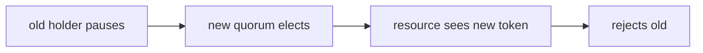

# A06.22 · split brain and stale lease holder

[Phase index](../README.md) · [Principal] · 25–40 minutes

Prerequisite [A06.21](A06.21.md) · Next [A06.23](A06.23.md)

## 1. The problem & why it exists

Both sides of a broken link consider themselves leader. Test partition plus pause plus delayed delivery, then inspect actual resource order.

## 2. Visual mental model



```text
01. old holder pauses
02. new quorum elects
03. resource sees new token
04. rejects old
```

Follow the responsibilities in order. The fixture isolates one mechanism. Check the workload and observation point before attributing the result to an actual deployment.

## 3. Step-by-step mechanism & minimal dry-run

Split brain means multiple components act as authority. Majority terms and a resource-enforced fence guard different boundaries. Granting a lock does not stop a paused holder's already-in-flight work.

**Trace.** old holder pauses → new quorum elects → resource sees new token → rejects old.

## 4. Formal rigor & quantitative math

For 3 replicas, a 2+1 partition cannot have two disjoint sets of 2. Stale in-flight messages can still need fencing.

Predict the worked quantities by hand, then run the [example](../examples/A06.22.py). It uses a small calculation or state model. For arithmetic, retain the units attached to the worked formula.

## 5. Progressive design

| Run | Expected fixture result | Interpretation |
| --- | --- | --- |
| Failure control | `True` | Which assumption from the opening problem leads to this result? |
| Normal control | `False` | Test partition plus pause plus delayed delivery, then inspect actual resource order. |

When the fixture reports a modeled value, use the lab to check the corresponding workload behavior. Compare work per request, retained bytes, and operational consequences only where the model measures them.

## 6. Safe local lab & controlled failure injection

```sh
uv run python "01-architecture-A01-to-A20/A06-distributed-systems-coordination/examples/A06.22.py"
uv run python "01-architecture-A01-to-A20/A06-distributed-systems-coordination/examples/A06.22.py" --break
```

Predict both results and identify which input or branch changes. Rerun the normal control as a repair. In a scratch copy, change one key, bound or assumption and predict the result again. Remove the scratch copy after recording your evidence. Apply this reasoning in [L4](../labs/L4.md).

## 7. Production & multi-cloud bridge

Test partition plus pause plus delayed delivery, then inspect actual resource order. For deployments on AWS, Azure or Google Cloud, confirm quotas, limits and which observations are available at each service boundary. Run production comparisons with the same query mix and recovery objective.

<details>
<summary>Principal question and answer</summary>

What evidence would distinguish the opening failure from a storage-capacity problem? Start with the first divergent boundary in the trace and name the exact mechanism. Split brain means multiple components act as authority. Majority terms and a resource-enforced fence guard different boundaries. Granting a lock does not stop a paused holder's already-in-flight work.

</details>

## 8. Memory hook & mastery checkpoint

1. Name the operation at the first stage in the trace.
2. Explain the normal and broken outputs before running them.
3. Change one input and compute the revised result with units.
4. How would you test this boundary at deployment scale?
5. What is one assumption that limits the fixture?

<details>
<summary>Check your reasoning</summary>

1. old holder pauses.
2. Normal `False`. Failure `True`.
3. Reapply the relationship in section 4 to your changed inputs.
4. Test partition plus pause plus delayed delivery, then inspect actual resource order.
5. The example uses a small calculation or state model. Check the primary reference for behavior outside that scope.

</details>

## Standards and implementation notes

- [Primary reference](https://raft.github.io/raft.pdf)
