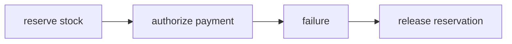

# A06.23 · transaction coordination and sagas

[Phase index](../README.md) · [Principal] · 25–40 minutes

Prerequisite [A06.22](A06.22.md) · Next [A06.24](A06.24.md)

## 1. The problem & why it exists

A distributed workflow cannot roll back external work as if it were one local transaction. Persist saga state and make retries and compensation idempotent. Do not promise isolation for intermediate states unless added.

## 2. Visual mental model



```text
01. reserve stock
02. authorize payment
03. failure
04. release reservation
```

Follow the responsibilities in order. The fixture isolates one mechanism. Check the workload and observation point before attributing the result to an actual deployment.

## 3. Step-by-step mechanism & minimal dry-run

Two-phase commit coordinates a transactional decision and can block in unresolved failure cases. A saga records workflow steps and compensations. Compensation is a business action and can fail or be retried.

**Trace.** reserve stock → authorize payment → failure → release reservation.

## 4. Formal rigor & quantitative math

In a three-step saga failing at step three after the first two succeed, two committed steps may need compensation, depending on workflow semantics.

Predict the worked quantities by hand, then run the [example](../examples/A06.23.py). It uses a small calculation or state model. For arithmetic, retain the units attached to the worked formula.

## 5. Progressive design

| Run | Expected fixture result | Interpretation |
| --- | --- | --- |
| Failure control | `0` | Which assumption from the opening problem leads to this result? |
| Normal control | `2` | Persist saga state and make retries and compensation idempotent. Do not promise isolation for intermediate states unless added. |

When the fixture reports a modeled value, use the lab to check the corresponding workload behavior. Compare work per request, retained bytes, and operational consequences only where the model measures them.

## 6. Safe local lab & controlled failure injection

```sh
uv run python "01-architecture-A01-to-A20/A06-distributed-systems-coordination/examples/A06.23.py"
uv run python "01-architecture-A01-to-A20/A06-distributed-systems-coordination/examples/A06.23.py" --break
```

Predict both results and identify which input or branch changes. Rerun the normal control as a repair. In a scratch copy, change one key, bound or assumption and predict the result again. Remove the scratch copy after recording your evidence. Apply this reasoning in [L2](../labs/L2.md).

## 7. Production & multi-cloud bridge

Persist saga state and make retries and compensation idempotent. Do not promise isolation for intermediate states unless added. For deployments on AWS, Azure or Google Cloud, confirm quotas, limits and which observations are available at each service boundary. Run production comparisons with the same query mix and recovery objective.

<details>
<summary>Principal question and answer</summary>

What evidence would distinguish the opening failure from a storage-capacity problem? Start with the first divergent boundary in the trace and name the exact mechanism. Two-phase commit coordinates a transactional decision and can block in unresolved failure cases. A saga records workflow steps and compensations. Compensation is a business action and can fail or be retried.

</details>

## 8. Memory hook & mastery checkpoint

1. Name the operation at the first stage in the trace.
2. Explain the normal and broken outputs before running them.
3. Change one input and compute the revised result with units.
4. How would you test this boundary at deployment scale?
5. What is one assumption that limits the fixture?

<details>
<summary>Check your reasoning</summary>

1. reserve stock.
2. Normal `2`. Failure `0`.
3. Reapply the relationship in section 4 to your changed inputs.
4. Persist saga state and make retries and compensation idempotent. Do not promise isolation for intermediate states unless added.
5. The example uses a small calculation or state model. Check the primary reference for behavior outside that scope.

</details>

## Standards and implementation notes

- [Primary reference](https://www.cs.cornell.edu/andru/cs711/2002fa/reading/sagas.pdf)
