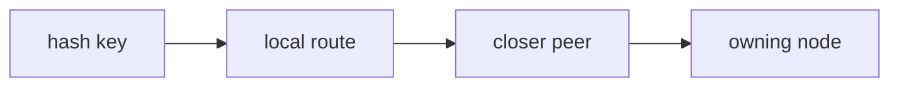

# A06.26 · distributed hash tables

[Phase index](../README.md) · [Principal] · 25–40 minutes

Prerequisite [A06.25](A06.25.md) · Next [A06.27](A06.27.md)

## 1. The problem & why it exists

A lookup visits every node to locate a distributed key. Check route repair and skew. Use a simpler map for small centrally controlled membership.

## 2. Visual mental model



```text
01. hash key
02. local route
03. closer peer
04. owning node
```

Follow the responsibilities in order. The fixture isolates one mechanism. Check the workload and observation point before attributing the result to an actual deployment.

## 3. Step-by-step mechanism & minimal dry-run

A distributed hash table routes via an overlay and limited routing state. The key and node-space mappings the protocol defines determine the next hop.

**Trace.** hash key → local route → closer peer → owning node.

## 4. Formal rigor & quantitative math

In a model that halves remaining distance each hop, 1024 positions require at most 10 reductions. Real lookup cost depends on topology and churn.

Predict the worked quantities by hand, then run the [example](../examples/A06.26.py). It uses a small calculation or state model. For arithmetic, retain the units attached to the worked formula.

## 5. Progressive design

| Run | Expected fixture result | Interpretation |
| --- | --- | --- |
| Failure control | `1024` | Which assumption from the opening problem leads to this result? |
| Normal control | `10` | Check route repair and skew. Use a simpler map for small centrally controlled membership. |

When the fixture reports a modeled value, use the lab to check the corresponding workload behavior. Compare work per request, retained bytes, and operational consequences only where the model measures them.

## 6. Safe local lab & controlled failure injection

```sh
uv run python "01-architecture-A01-to-A20/A06-distributed-systems-coordination/examples/A06.26.py"
uv run python "01-architecture-A01-to-A20/A06-distributed-systems-coordination/examples/A06.26.py" --break
```

Predict both results and identify which input or branch changes. Rerun the normal control as a repair. In a scratch copy, change one key, bound or assumption and predict the result again. Remove the scratch copy after recording your evidence. Apply this reasoning in [L2](../labs/L2.md).

## 7. Production & multi-cloud bridge

Check route repair and skew. Use a simpler map for small centrally controlled membership. For deployments on AWS, Azure or Google Cloud, confirm quotas, limits and which observations are available at each service boundary. Run production comparisons with the same query mix and recovery objective.

<details>
<summary>Principal question and answer</summary>

What evidence would distinguish the opening failure from a storage-capacity problem? Start with the first divergent boundary in the trace and name the exact mechanism. A distributed hash table routes via an overlay and limited routing state. The key and node-space mappings the protocol defines determine the next hop.

</details>

## 8. Memory hook & mastery checkpoint

1. Name the operation at the first stage in the trace.
2. Explain the normal and broken outputs before running them.
3. Change one input and compute the revised result with units.
4. How would you test this boundary at deployment scale?
5. What is one assumption that limits the fixture?

<details>
<summary>Check your reasoning</summary>

1. hash key.
2. Normal `10`. Failure `1024`.
3. Reapply the relationship in section 4 to your changed inputs.
4. Check route repair and skew. Use a simpler map for small centrally controlled membership.
5. The example uses a small calculation or state model. Check the primary reference for behavior outside that scope.

</details>

## Standards and implementation notes

- [Primary reference](https://pdos.csail.mit.edu/papers/chord:sigcomm01/chord_sigcomm.pdf)
