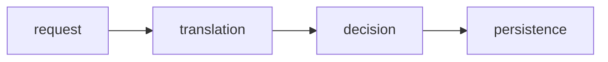

# A07.01 · separation of concerns

[Phase index](../README.md) · [Foundation] · 25–40 minutes

Prerequisite [A06 gate](../../A06-distributed-systems-coordination/README.md#practice-and-exit-gate) · Next [A07.02](A07.02.md)

## 1. The problem & why it exists

A price rule can only be tested by starting a web server. Keep the decision callable directly while testing the wiring independently.

## 2. Visual mental model



```text
01. request
02. translation
03. decision
04. persistence
```

Follow the responsibilities in order. The fixture isolates one mechanism. Check the workload and observation point before attributing the result to an actual deployment.

## 3. Step-by-step mechanism & minimal dry-run

Request parsing, business decisions and persistence have different reasons to change. A pure decision accepts business inputs, while a handler translates request and response contracts.

**Trace.** request → translation → decision → persistence.

## 4. Formal rigor & quantitative math

Four pricing cases and three protocol cases need seven focused checks before a small integration suite. Crossing every input with every protocol case would produce twelve combinations.

Predict the worked quantities by hand, then run the [example](../examples/A07.01.py). It uses a small calculation or state model. For arithmetic, retain the units attached to the worked formula.

## 5. Progressive design

| Run | Expected fixture result | Interpretation |
| --- | --- | --- |
| Failure control | `12` | Which assumption from the opening problem leads to this result? |
| Normal control | `7` | Keep the decision callable directly while testing the wiring independently. |

When the fixture reports a modeled value, use the lab to check the corresponding workload behavior. Compare work per request, retained bytes, and operational consequences only where the model measures them.

## 6. Safe local lab & controlled failure injection

```sh
uv run python "01-architecture-A01-to-A20/A07-application-integration-arch/examples/A07.01.py"
uv run python "01-architecture-A01-to-A20/A07-application-integration-arch/examples/A07.01.py" --break
```

Predict both results and identify which input or branch changes. Rerun the normal control as a repair. In a scratch copy, change one key, bound or assumption and predict the result again. Remove the scratch copy after recording your evidence. Apply this reasoning in [L1](../labs/L1.md).

## 7. Production & multi-cloud bridge

Keep the decision callable directly while testing the wiring independently. For deployments on AWS, Azure or Google Cloud, confirm quotas, limits and which observations are available at each service boundary. Run production comparisons with the same query mix and recovery objective.

<details>
<summary>Principal question and answer</summary>

What evidence would distinguish the opening failure from a storage-capacity problem? Start with the first divergent boundary in the trace and name the exact mechanism. Request parsing, business decisions and persistence have different reasons to change. A pure decision accepts business inputs, while a handler translates request and response contracts.

</details>

## 8. Memory hook & mastery checkpoint

1. Name the operation at the first stage in the trace.
2. Explain the normal and broken outputs before running them.
3. Change one input and compute the revised result with units.
4. How would you test this boundary at deployment scale?
5. What is one assumption that limits the fixture?

<details>
<summary>Check your reasoning</summary>

1. request.
2. Normal `7`. Failure `12`.
3. Reapply the relationship in section 4 to your changed inputs.
4. Keep the decision callable directly while testing the wiring independently.
5. The example uses a small calculation or state model. Check the primary reference for behavior outside that scope.

</details>

## Standards and implementation notes

- [Primary reference](https://alistair.cockburn.us/hexagonal-architecture/)
