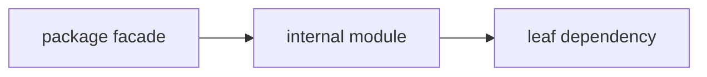

# A07.03 · modules and packages

[Phase index](../README.md) · [Foundation] · 25–40 minutes

Prerequisite [A07.02](A07.02.md) · Next [A07.04](A07.04.md)

## 1. The problem & why it exists

An internal helper becomes impossible to change because other modules import it. Expose a small explicit API and avoid import cycles or import-time infrastructure work.

## 2. Visual mental model



```text
01. package facade
02. internal module
03. leaf dependency
```

Follow the responsibilities in order. The fixture isolates one mechanism. Check the workload and observation point before attributing the result to an actual deployment.

## 3. Step-by-step mechanism & minimal dry-run

A module scopes names. A package organizes modules and controls the public interface by convention and documented exports. Python internal naming is not an access control boundary.

**Trace.** package facade → internal module → leaf dependency.

## 4. Formal rigor & quantitative math

Ten public exports with two contract cases each require twenty checks. A facade with three exports needs six under the same test model.

Predict the worked quantities by hand, then run the [example](../examples/A07.03.py). It uses a small calculation or state model. For arithmetic, retain the units attached to the worked formula.

## 5. Progressive design

| Run | Expected fixture result | Interpretation |
| --- | --- | --- |
| Failure control | `20` | Which assumption from the opening problem leads to this result? |
| Normal control | `6` | Expose a small explicit API and avoid import cycles or import-time infrastructure work. |

When the fixture reports a modeled value, use the lab to check the corresponding workload behavior. Compare work per request, retained bytes, and operational consequences only where the model measures them.

## 6. Safe local lab & controlled failure injection

```sh
uv run python "01-architecture-A01-to-A20/A07-application-integration-arch/examples/A07.03.py"
uv run python "01-architecture-A01-to-A20/A07-application-integration-arch/examples/A07.03.py" --break
```

Predict both results and identify which input or branch changes. Rerun the normal control as a repair. In a scratch copy, change one key, bound or assumption and predict the result again. Remove the scratch copy after recording your evidence. Apply this reasoning in [L4](../labs/L4.md).

## 7. Production & multi-cloud bridge

Expose a small explicit API and avoid import cycles or import-time infrastructure work. For deployments on AWS, Azure or Google Cloud, confirm quotas, limits and which observations are available at each service boundary. Run production comparisons with the same query mix and recovery objective.

<details>
<summary>Principal question and answer</summary>

What evidence would distinguish the opening failure from a storage-capacity problem? Start with the first divergent boundary in the trace and name the exact mechanism. A module scopes names. A package organizes modules and controls the public interface by convention and documented exports. Python internal naming is not an access control boundary.

</details>

## 8. Memory hook & mastery checkpoint

1. Name the operation at the first stage in the trace.
2. Explain the normal and broken outputs before running them.
3. Change one input and compute the revised result with units.
4. How would you test this boundary at deployment scale?
5. What is one assumption that limits the fixture?

<details>
<summary>Check your reasoning</summary>

1. package facade.
2. Normal `6`. Failure `20`.
3. Reapply the relationship in section 4 to your changed inputs.
4. Expose a small explicit API and avoid import cycles or import-time infrastructure work.
5. The example uses a small calculation or state model. Check the primary reference for behavior outside that scope.

</details>

## Standards and implementation notes

- [Primary reference](https://docs.python.org/3/tutorial/modules.html)
