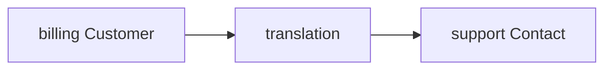

# A07.09 · domain-driven design bounded contexts

[Phase index](../README.md) · [Core] · 25–40 minutes

Prerequisite [A07.08](A07.08.md) · Next [A07.10](A07.10.md)

## 1. The problem & why it exists

Two teams use the word customer but attach different rules to the same field. Choose boundaries from invariants and language, then translate identifiers and meanings explicitly.

## 2. Visual mental model



```text
01. billing Customer
02. translation
03. support Contact
```

Follow the responsibilities in order. The fixture isolates one mechanism. Check the workload and observation point before attributing the result to an actual deployment.

## 3. Step-by-step mechanism & minimal dry-run

A bounded context defines where a domain model and language are internally consistent. Translation across contexts is explicit and does not require a shared persistence schema.

**Trace.** billing Customer → translation → support Contact.

## 4. Formal rigor & quantitative math

Three contexts can produce up to 3×2=6 directed pairwise translations. Document the actual edges instead of assuming all exist.

Predict the worked quantities by hand, then run the [example](../examples/A07.09.py). It uses a small calculation or state model. For arithmetic, retain the units attached to the worked formula.

## 5. Progressive design

| Run | Expected fixture result | Interpretation |
| --- | --- | --- |
| Failure control | `1` | Which assumption from the opening problem leads to this result? |
| Normal control | `6` | Choose boundaries from invariants and language, then translate identifiers and meanings explicitly. |

When the fixture reports a modeled value, use the lab to check the corresponding workload behavior. Compare work per request, retained bytes, and operational consequences only where the model measures them.

## 6. Safe local lab & controlled failure injection

```sh
uv run python "01-architecture-A01-to-A20/A07-application-integration-arch/examples/A07.09.py"
uv run python "01-architecture-A01-to-A20/A07-application-integration-arch/examples/A07.09.py" --break
```

Predict both results and identify which input or branch changes. Rerun the normal control as a repair. In a scratch copy, change one key, bound or assumption and predict the result again. Remove the scratch copy after recording your evidence. Apply this reasoning in [L4](../labs/L4.md).

## 7. Production & multi-cloud bridge

Choose boundaries from invariants and language, then translate identifiers and meanings explicitly. For deployments on AWS, Azure or Google Cloud, confirm quotas, limits and which observations are available at each service boundary. Run production comparisons with the same query mix and recovery objective.

<details>
<summary>Principal question and answer</summary>

What evidence would distinguish the opening failure from a storage-capacity problem? Start with the first divergent boundary in the trace and name the exact mechanism. A bounded context defines where a domain model and language are internally consistent. Translation across contexts is explicit and does not require a shared persistence schema.

</details>

## 8. Memory hook & mastery checkpoint

1. Name the operation at the first stage in the trace.
2. Explain the normal and broken outputs before running them.
3. Change one input and compute the revised result with units.
4. How would you test this boundary at deployment scale?
5. What is one assumption that limits the fixture?

<details>
<summary>Check your reasoning</summary>

1. billing Customer.
2. Normal `6`. Failure `1`.
3. Reapply the relationship in section 4 to your changed inputs.
4. Choose boundaries from invariants and language, then translate identifiers and meanings explicitly.
5. The example uses a small calculation or state model. Check the primary reference for behavior outside that scope.

</details>

## Standards and implementation notes

- [Primary reference](https://www.domainlanguage.com/ddd/reference/)
