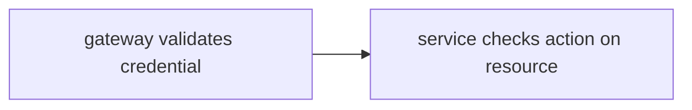

# A07.12 · API gateway vs service

[Phase index](../README.md) · [Core] · 25–40 minutes

Prerequisite [A07.11](A07.11.md) · Next [A07.13](A07.13.md)

## 1. The problem & why it exists

A gateway's authorization check is assumed to protect every object behind it. Put request routing at the edge and protect resource invariants at the owner.

## 2. Visual mental model



```text
01. gateway validates credential
02. service checks action on resource
```

Follow the responsibilities in order. The fixture isolates one mechanism. Check the workload and observation point before attributing the result to an actual deployment.

## 3. Step-by-step mechanism & minimal dry-run

A gateway handles shared edge policy such as routing and broad credential validation. The service owns resource-level authorization and business policy.

**Trace.** gateway validates credential → service checks action on resource.

## 4. Formal rigor & quantitative math

At three services behind one gateway, credential verification policy can be centralized, while all three service-level access contracts still need coverage.

Predict the worked quantities by hand, then run the [example](../examples/A07.12.py). It uses a small calculation or state model. For arithmetic, retain the units attached to the worked formula.

## 5. Progressive design

| Run | Expected fixture result | Interpretation |
| --- | --- | --- |
| Failure control | `1` | Which assumption from the opening problem leads to this result? |
| Normal control | `3` | Put request routing at the edge and protect resource invariants at the owner. |

When the fixture reports a modeled value, use the lab to check the corresponding workload behavior. Compare work per request, retained bytes, and operational consequences only where the model measures them.

## 6. Safe local lab & controlled failure injection

```sh
uv run python "01-architecture-A01-to-A20/A07-application-integration-arch/examples/A07.12.py"
uv run python "01-architecture-A01-to-A20/A07-application-integration-arch/examples/A07.12.py" --break
```

Predict both results and identify which input or branch changes. Rerun the normal control as a repair. In a scratch copy, change one key, bound or assumption and predict the result again. Remove the scratch copy after recording your evidence. Apply this reasoning in [L1](../labs/L1.md).

## 7. Production & multi-cloud bridge

Put request routing at the edge and protect resource invariants at the owner. For deployments on AWS, Azure or Google Cloud, confirm quotas, limits and which observations are available at each service boundary. Run production comparisons with the same query mix and recovery objective.

<details>
<summary>Principal question and answer</summary>

What evidence would distinguish the opening failure from a storage-capacity problem? Start with the first divergent boundary in the trace and name the exact mechanism. A gateway handles shared edge policy such as routing and broad credential validation. The service owns resource-level authorization and business policy.

</details>

## 8. Memory hook & mastery checkpoint

1. Name the operation at the first stage in the trace.
2. Explain the normal and broken outputs before running them.
3. Change one input and compute the revised result with units.
4. How would you test this boundary at deployment scale?
5. What is one assumption that limits the fixture?

<details>
<summary>Check your reasoning</summary>

1. gateway validates credential.
2. Normal `3`. Failure `1`.
3. Reapply the relationship in section 4 to your changed inputs.
4. Put request routing at the edge and protect resource invariants at the owner.
5. The example uses a small calculation or state model. Check the primary reference for behavior outside that scope.

</details>

## Standards and implementation notes

- [Primary reference](https://learn.microsoft.com/en-us/azure/architecture/microservices/design/gateway)
