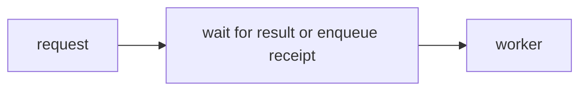

# A07.13 · synchronous API vs queue vs stream

[Phase index](../README.md) · [Core] · 25–40 minutes

Prerequisite [A07.12](A07.12.md) · Next [A07.14](A07.14.md)

## 1. The problem & why it exists

A caller waits for work whose result it does not need yet. Choose according to required response semantics and control queue age, retries and overload.

## 2. Visual mental model



```text
01. request
02. wait for result or enqueue receipt
03. worker
```

Follow the responsibilities in order. The fixture isolates one mechanism. Check the workload and observation point before attributing the result to an actual deployment.

## 3. Step-by-step mechanism & minimal dry-run

A synchronous API couples completion to the request. A queue accepts independent work with an acknowledgment contract. A stream retains ordered records by its partition policy for multiple reader positions.

**Trace.** request → wait for result or enqueue receipt → worker.

## 4. Formal rigor & quantitative math

At 20 arrivals/s and 2 s mean residence, a stable stage contains about 40 requests on average. Enqueueing does not eliminate backlog.

Predict the worked quantities by hand, then run the [example](../examples/A07.13.py). It uses a small calculation or state model. For arithmetic, retain the units attached to the worked formula.

## 5. Progressive design

| Run | Expected fixture result | Interpretation |
| --- | --- | --- |
| Failure control | `20` | Which assumption from the opening problem leads to this result? |
| Normal control | `40` | Choose according to required response semantics and control queue age, retries and overload. |

When the fixture reports a modeled value, use the lab to check the corresponding workload behavior. Compare work per request, retained bytes, and operational consequences only where the model measures them.

## 6. Safe local lab & controlled failure injection

```sh
uv run python "01-architecture-A01-to-A20/A07-application-integration-arch/examples/A07.13.py"
uv run python "01-architecture-A01-to-A20/A07-application-integration-arch/examples/A07.13.py" --break
```

Predict both results and identify which input or branch changes. Rerun the normal control as a repair. In a scratch copy, change one key, bound or assumption and predict the result again. Remove the scratch copy after recording your evidence. Apply this reasoning in [L1](../labs/L1.md).

## 7. Production & multi-cloud bridge

Choose according to required response semantics and control queue age, retries and overload. For deployments on AWS, Azure or Google Cloud, confirm quotas, limits and which observations are available at each service boundary. Run production comparisons with the same query mix and recovery objective.

<details>
<summary>Principal question and answer</summary>

What evidence would distinguish the opening failure from a storage-capacity problem? Start with the first divergent boundary in the trace and name the exact mechanism. A synchronous API couples completion to the request. A queue accepts independent work with an acknowledgment contract. A stream retains ordered records by its partition policy for multiple reader positions.

</details>

## 8. Memory hook & mastery checkpoint

1. Name the operation at the first stage in the trace.
2. Explain the normal and broken outputs before running them.
3. Change one input and compute the revised result with units.
4. How would you test this boundary at deployment scale?
5. What is one assumption that limits the fixture?

<details>
<summary>Check your reasoning</summary>

1. request.
2. Normal `40`. Failure `20`.
3. Reapply the relationship in section 4 to your changed inputs.
4. Choose according to required response semantics and control queue age, retries and overload.
5. The example uses a small calculation or state model. Check the primary reference for behavior outside that scope.

</details>

## Standards and implementation notes

- [Primary reference](https://learn.microsoft.com/en-us/azure/architecture/patterns/queue-based-load-leveling)
