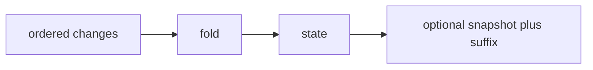

# A07.16 · event sourcing

[Phase index](../README.md) · [Core] · 25–40 minutes

Prerequisite [A07.15](A07.15.md) · Next [A07.17](A07.17.md)

## 1. The problem & why it exists

A historical event is edited in place and no longer reproduces prior decisions. Version events and decouple replay from external side effects.

## 2. Visual mental model



```text
01. ordered changes
02. fold
03. state
04. optional snapshot plus suffix
```

Follow the responsibilities in order. The fixture isolates one mechanism. Check the workload and observation point before attributing the result to an actual deployment.

## 3. Step-by-step mechanism & minimal dry-run

Event sourcing stores facts as an append-only event history. Current state is folded from the sequence; snapshots reduce replay work while preserving event interpretation requirements.

**Trace.** ordered changes → fold → state; optional snapshot plus suffix.

## 4. Formal rigor & quantitative math

A snapshot at event 9000 of 10000 reduces replay from 10000 to 1000 events, excluding snapshot loading.

Predict the worked quantities by hand, then run the [example](../examples/A07.16.py). It uses a small calculation or state model. For arithmetic, retain the units attached to the worked formula.

## 5. Progressive design

| Run | Expected fixture result | Interpretation |
| --- | --- | --- |
| Failure control | `10000` | Which assumption from the opening problem leads to this result? |
| Normal control | `1000` | Version events and decouple replay from external side effects. |

When the fixture reports a modeled value, use the lab to check the corresponding workload behavior. Compare work per request, retained bytes, and operational consequences only where the model measures them.

## 6. Safe local lab & controlled failure injection

```sh
uv run python "01-architecture-A01-to-A20/A07-application-integration-arch/examples/A07.16.py"
uv run python "01-architecture-A01-to-A20/A07-application-integration-arch/examples/A07.16.py" --break
```

Predict both results and identify which input or branch changes. Rerun the normal control as a repair. In a scratch copy, change one key, bound or assumption and predict the result again. Remove the scratch copy after recording your evidence. Apply this reasoning in [L3](../labs/L3.md).

## 7. Production & multi-cloud bridge

Version events and decouple replay from external side effects. For deployments on AWS, Azure or Google Cloud, confirm quotas, limits and which observations are available at each service boundary. Run production comparisons with the same query mix and recovery objective.

<details>
<summary>Principal question and answer</summary>

What evidence would distinguish the opening failure from a storage-capacity problem? Start with the first divergent boundary in the trace and name the exact mechanism. Event sourcing stores facts as an append-only event history. Current state is folded from the sequence; snapshots reduce replay work while preserving event interpretation requirements.

</details>

## 8. Memory hook & mastery checkpoint

1. Name the operation at the first stage in the trace.
2. Explain the normal and broken outputs before running them.
3. Change one input and compute the revised result with units.
4. How would you test this boundary at deployment scale?
5. What is one assumption that limits the fixture?

<details>
<summary>Check your reasoning</summary>

1. ordered changes.
2. Normal `1000`. Failure `10000`.
3. Reapply the relationship in section 4 to your changed inputs.
4. Version events and decouple replay from external side effects.
5. The example uses a small calculation or state model. Check the primary reference for behavior outside that scope.

</details>

## Standards and implementation notes

- [Primary reference](https://learn.microsoft.com/en-us/azure/architecture/patterns/event-sourcing)
