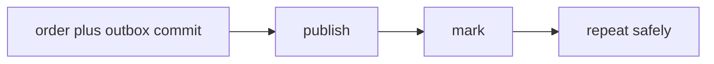

# A07.17 · transactional outbox

[Phase index](../README.md) · [Core] · 25–40 minutes

Prerequisite [A07.16](A07.16.md) · Next [A07.18](A07.18.md)

## 1. The problem & why it exists

Checkout commits a row but fails to contact the broker. Label database, broker and consumer boundaries and test each failure window separately.

## 2. Visual mental model



```text
01. order plus outbox commit
02. publish
03. mark
04. repeat safely
```

Follow the responsibilities in order. The fixture isolates one mechanism. Check the workload and observation point before attributing the result to an actual deployment.

## 3. Step-by-step mechanism & minimal dry-run

Write business state and an outbox record in one database transaction. Publish after commit. A crash after publishing and before recording success may repeat delivery, so use a durable consumer receipt.

**Trace.** order plus outbox commit → publish → mark; repeat safely.

**Part A · Producer atomicity.** Insert the business record and outbox event in the same transaction. A rollback leaves neither. The producer may return as soon as its own contract permits acknowledgment of that commit.

**Part B · Relay and consumer.** If publication succeeds but the relay cannot mark it sent, another attempt can repeat delivery. Store a consumer receipt or an idempotent projection under the same stable event ID. If the effect uses another external system, its own idempotency contract matters. The [independent pipeline](../projects/independent/README.md) verifies both the relay and acknowledgment failure windows.

## 4. Formal rigor & quantitative math

One event with one retry can produce two broker deliveries and one durable consumer effect with correctly scoped deduplication.

Predict the worked quantities by hand, then run the [example](../examples/A07.17.py). It uses a small calculation or state model. For arithmetic, retain the units attached to the worked formula.

## 5. Progressive design

| Run | Expected fixture result | Interpretation |
| --- | --- | --- |
| Failure control | `2` | Which assumption from the opening problem leads to this result? |
| Normal control | `1` | Label database, broker and consumer boundaries and test each failure window separately. |

When the fixture reports a modeled value, use the lab to check the corresponding workload behavior. Compare work per request, retained bytes, and operational consequences only where the model measures them.

## 6. Safe local lab & controlled failure injection

```sh
uv run python "01-architecture-A01-to-A20/A07-application-integration-arch/examples/A07.17.py"
uv run python "01-architecture-A01-to-A20/A07-application-integration-arch/examples/A07.17.py" --break
```

Predict both results and identify which input or branch changes. Rerun the normal control as a repair. In a scratch copy, change one key, bound or assumption and predict the result again. Remove the scratch copy after recording your evidence. Apply this reasoning in [L3](../labs/L3.md).

## 7. Production & multi-cloud bridge

Label database, broker and consumer boundaries and test each failure window separately. For deployments on AWS, Azure or Google Cloud, confirm quotas, limits and which observations are available at each service boundary. Run production comparisons with the same query mix and recovery objective.

<details>
<summary>Principal question and answer</summary>

What evidence would distinguish the opening failure from a storage-capacity problem? Start with the first divergent boundary in the trace and name the exact mechanism. Write business state and an outbox record in one database transaction. Publish after commit. A crash after publishing and before recording success may repeat delivery, so use a durable consumer receipt.

</details>

## 8. Memory hook & mastery checkpoint

1. Name the operation at the first stage in the trace.
2. Explain the normal and broken outputs before running them.
3. Change one input and compute the revised result with units.
4. How would you test this boundary at deployment scale?
5. What is one assumption that limits the fixture?

<details>
<summary>Check your reasoning</summary>

1. order plus outbox commit.
2. Normal `1`. Failure `2`.
3. Reapply the relationship in section 4 to your changed inputs.
4. Label database, broker and consumer boundaries and test each failure window separately.
5. The example uses a small calculation or state model. Check the primary reference for behavior outside that scope.

</details>

## Standards and implementation notes

- [Primary reference](https://docs.aws.amazon.com/prescriptive-guidance/latest/cloud-design-patterns/transactional-outbox.html)
