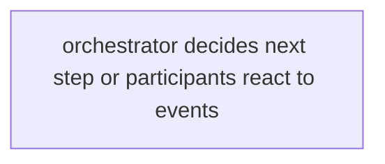

# A07.21 · workflow engines vs event choreography

[Phase index](../README.md) · [Principal] · 25–40 minutes

Prerequisite [A07.20](A07.20.md) · Next [A07.22](A07.22.md)

## 1. The problem & why it exists

No service owns an order workflow that can time out or branch. Choose based on ownership, visibility and failure recovery. Count dependencies and operational effort.

## 2. Visual mental model



```text
01. orchestrator decides next step or participants react to events
```

Follow the responsibilities in order. The fixture isolates one mechanism. Check the workload and observation point before attributing the result to an actual deployment.

## 3. Step-by-step mechanism & minimal dry-run

An orchestrator records state and issues commands. In choreography, participants react to events and infer progress from local facts. Both need step identity and recovery semantics.

**Trace.** orchestrator decides next step or participants react to events.

## 4. Formal rigor & quantitative math

Six participants with all-to-all directed subscriptions could create 30 relationships; an orchestrator with one command and one reply per participant has 12 such edges in the simplified topology.

Predict the worked quantities by hand, then run the [example](../examples/A07.21.py). It uses a small calculation or state model. For arithmetic, retain the units attached to the worked formula.

## 5. Progressive design

| Run | Expected fixture result | Interpretation |
| --- | --- | --- |
| Failure control | `30` | Which assumption from the opening problem leads to this result? |
| Normal control | `12` | Choose based on ownership, visibility and failure recovery. Count dependencies and operational effort. |

When the fixture reports a modeled value, use the lab to check the corresponding workload behavior. Compare work per request, retained bytes, and operational consequences only where the model measures them.

## 6. Safe local lab & controlled failure injection

```sh
uv run python "01-architecture-A01-to-A20/A07-application-integration-arch/examples/A07.21.py"
uv run python "01-architecture-A01-to-A20/A07-application-integration-arch/examples/A07.21.py" --break
```

Predict both results and identify which input or branch changes. Rerun the normal control as a repair. In a scratch copy, change one key, bound or assumption and predict the result again. Remove the scratch copy after recording your evidence. Apply this reasoning in [L3](../labs/L3.md).

## 7. Production & multi-cloud bridge

Choose based on ownership, visibility and failure recovery. Count dependencies and operational effort. For deployments on AWS, Azure or Google Cloud, confirm quotas, limits and which observations are available at each service boundary. Run production comparisons with the same query mix and recovery objective.

<details>
<summary>Principal question and answer</summary>

What evidence would distinguish the opening failure from a storage-capacity problem? Start with the first divergent boundary in the trace and name the exact mechanism. An orchestrator records state and issues commands. In choreography, participants react to events and infer progress from local facts. Both need step identity and recovery semantics.

</details>

## 8. Memory hook & mastery checkpoint

1. Name the operation at the first stage in the trace.
2. Explain the normal and broken outputs before running them.
3. Change one input and compute the revised result with units.
4. How would you test this boundary at deployment scale?
5. What is one assumption that limits the fixture?

<details>
<summary>Check your reasoning</summary>

1. orchestrator decides next step or participants react to events.
2. Normal `12`. Failure `30`.
3. Reapply the relationship in section 4 to your changed inputs.
4. Choose based on ownership, visibility and failure recovery. Count dependencies and operational effort.
5. The example uses a small calculation or state model. Check the primary reference for behavior outside that scope.

</details>

## Standards and implementation notes

- [Primary reference](https://www.cs.cornell.edu/andru/cs711/2002fa/reading/sagas.pdf)
