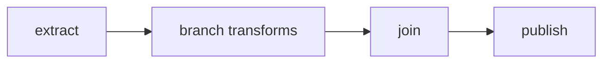

# A07.22 · DAG orchestration

[Phase index](../README.md) · [Principal] · 25–40 minutes

Prerequisite [A07.21](A07.21.md) · Next [A07.23](A07.23.md)

## 1. The problem & why it exists

A job starts before all of its prerequisites are ready. Model retries and failure propagation separately from graph topology.

## 2. Visual mental model



```text
01. extract
02. branch transforms
03. join
04. publish
```

Follow the responsibilities in order. The fixture isolates one mechanism. Check the workload and observation point before attributing the result to an actual deployment.

## 3. Step-by-step mechanism & minimal dry-run

A DAG describes dependency relations and has no directed cycles. A scheduler marks tasks ready only after dependencies meet the selected trigger conditions.

**Trace.** extract → branch transforms → join → publish.

## 4. Formal rigor & quantitative math

For upstream stages of 10 ms then parallel branches of 20 and 30 ms, the critical path is 40 ms before the join's own processing.

Predict the worked quantities by hand, then run the [example](../examples/A07.22.py). It uses a small calculation or state model. For arithmetic, retain the units attached to the worked formula.

## 5. Progressive design

| Run | Expected fixture result | Interpretation |
| --- | --- | --- |
| Failure control | `60` | Which assumption from the opening problem leads to this result? |
| Normal control | `40` | Model retries and failure propagation separately from graph topology. |

When the fixture reports a modeled value, use the lab to check the corresponding workload behavior. Compare work per request, retained bytes, and operational consequences only where the model measures them.

## 6. Safe local lab & controlled failure injection

```sh
uv run python "01-architecture-A01-to-A20/A07-application-integration-arch/examples/A07.22.py"
uv run python "01-architecture-A01-to-A20/A07-application-integration-arch/examples/A07.22.py" --break
```

Predict both results and identify which input or branch changes. Rerun the normal control as a repair. In a scratch copy, change one key, bound or assumption and predict the result again. Remove the scratch copy after recording your evidence. Apply this reasoning in [L1](../labs/L1.md).

## 7. Production & multi-cloud bridge

Model retries and failure propagation separately from graph topology. For deployments on AWS, Azure or Google Cloud, confirm quotas, limits and which observations are available at each service boundary. Run production comparisons with the same query mix and recovery objective.

<details>
<summary>Principal question and answer</summary>

What evidence would distinguish the opening failure from a storage-capacity problem? Start with the first divergent boundary in the trace and name the exact mechanism. A DAG describes dependency relations and has no directed cycles. A scheduler marks tasks ready only after dependencies meet the selected trigger conditions.

</details>

## 8. Memory hook & mastery checkpoint

1. Name the operation at the first stage in the trace.
2. Explain the normal and broken outputs before running them.
3. Change one input and compute the revised result with units.
4. How would you test this boundary at deployment scale?
5. What is one assumption that limits the fixture?

<details>
<summary>Check your reasoning</summary>

1. extract.
2. Normal `40`. Failure `60`.
3. Reapply the relationship in section 4 to your changed inputs.
4. Model retries and failure propagation separately from graph topology.
5. The example uses a small calculation or state model. Check the primary reference for behavior outside that scope.

</details>

## Standards and implementation notes

- [Primary reference](https://airflow.apache.org/docs/apache-airflow/stable/core-concepts/dags.html)
