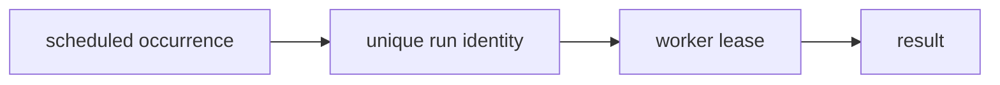

# A07.23 · job scheduler

[Phase index](../README.md) · [Principal] · 25–40 minutes

Prerequisite [A07.22](A07.22.md) · Next [A07.24](A07.24.md)

## 1. The problem & why it exists

A retried scheduled job creates the same invoice twice. Define catch-up, overlap limits and durable idempotence at the effect boundary.

## 2. Visual mental model



```text
01. scheduled occurrence
02. unique run identity
03. worker lease
04. result
```

Follow the responsibilities in order. The fixture isolates one mechanism. Check the workload and observation point before attributing the result to an actual deployment.

## 3. Step-by-step mechanism & minimal dry-run

Schedulers trigger runs under timing, catch-up and overlap policies. Persist a run identity such as job name and scheduled occurrence, and specify how runs recover.

**Trace.** scheduled occurrence → unique run identity → worker lease → result.

## 4. Formal rigor & quantitative math

A five-minute cadence over an outage of 20 minutes can miss four intended ticks depending on endpoint convention.

Predict the worked quantities by hand, then run the [example](../examples/A07.23.py). It uses a small calculation or state model. For arithmetic, retain the units attached to the worked formula.

## 5. Progressive design

| Run | Expected fixture result | Interpretation |
| --- | --- | --- |
| Failure control | `8` | Which assumption from the opening problem leads to this result? |
| Normal control | `4` | Define catch-up, overlap limits and durable idempotence at the effect boundary. |

When the fixture reports a modeled value, use the lab to check the corresponding workload behavior. Compare work per request, retained bytes, and operational consequences only where the model measures them.

## 6. Safe local lab & controlled failure injection

```sh
uv run python "01-architecture-A01-to-A20/A07-application-integration-arch/examples/A07.23.py"
uv run python "01-architecture-A01-to-A20/A07-application-integration-arch/examples/A07.23.py" --break
```

Predict both results and identify which input or branch changes. Rerun the normal control as a repair. In a scratch copy, change one key, bound or assumption and predict the result again. Remove the scratch copy after recording your evidence. Apply this reasoning in [L1](../labs/L1.md).

## 7. Production & multi-cloud bridge

Define catch-up, overlap limits and durable idempotence at the effect boundary. For deployments on AWS, Azure or Google Cloud, confirm quotas, limits and which observations are available at each service boundary. Run production comparisons with the same query mix and recovery objective.

<details>
<summary>Principal question and answer</summary>

What evidence would distinguish the opening failure from a storage-capacity problem? Start with the first divergent boundary in the trace and name the exact mechanism. Schedulers trigger runs under timing, catch-up and overlap policies. Persist a run identity such as job name and scheduled occurrence, and specify how runs recover.

</details>

## 8. Memory hook & mastery checkpoint

1. Name the operation at the first stage in the trace.
2. Explain the normal and broken outputs before running them.
3. Change one input and compute the revised result with units.
4. How would you test this boundary at deployment scale?
5. What is one assumption that limits the fixture?

<details>
<summary>Check your reasoning</summary>

1. scheduled occurrence.
2. Normal `4`. Failure `8`.
3. Reapply the relationship in section 4 to your changed inputs.
4. Define catch-up, overlap limits and durable idempotence at the effect boundary.
5. The example uses a small calculation or state model. Check the primary reference for behavior outside that scope.

</details>

## Standards and implementation notes

- [Primary reference](https://kubernetes.io/docs/concepts/workloads/controllers/cron-jobs/)
