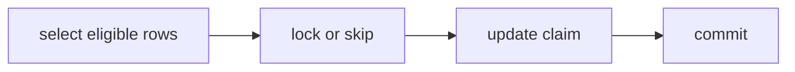

# A07.24 · SKIP LOCKED queues

[Phase index](../README.md) · [Principal] · 25–40 minutes

Prerequisite [A07.23](A07.23.md) · Next [A07.25](A07.25.md)

## 1. The problem & why it exists

Two workers claim the same queue row after reading it unlocked. Claim and transition in one transaction. Design lease expiry and acknowledge without assuming strict FIFO.

## 2. Visual mental model



```text
01. select eligible rows
02. lock or skip
03. update claim
04. commit
```

Follow the responsibilities in order. The fixture isolates one mechanism. Check the workload and observation point before attributing the result to an actual deployment.

## 3. Step-by-step mechanism & minimal dry-run

FOR UPDATE locks eligible rows. PostgreSQL SKIP LOCKED can skip rows already locked by others, useful for competing queue consumers. It intentionally gives an inconsistent selection view.

**Trace.** select eligible rows → lock or skip → update claim → commit.

Run equivalent claims in separate PostgreSQL transactions. Keep the selection and lease update in the same statement or transaction.

```sql
WITH candidates AS (
    SELECT id
    FROM jobs
    WHERE status = 'ready'
    ORDER BY id
    LIMIT 10
    FOR UPDATE SKIP LOCKED
)
UPDATE jobs AS j
SET status = 'claimed'
FROM candidates AS c
WHERE j.id = c.id
RETURNING j.id;
```

The fixture assumes integer keys and a status column. While one transaction holds locks, the other may claim later rows. Add a lease deadline, ownership validation, and a recovery path before using this pattern in a worker system.

## 4. Formal rigor & quantitative math

With batch limit 10 and three workers, up to 30 rows may be claimed in one round under disjoint locks.

Predict the worked quantities by hand, then run the [example](../examples/A07.24.py). It uses a small calculation or state model. For arithmetic, retain the units attached to the worked formula.

## 5. Progressive design

| Run | Expected fixture result | Interpretation |
| --- | --- | --- |
| Failure control | `10` | Which assumption from the opening problem leads to this result? |
| Normal control | `30` | Claim and transition in one transaction. Design lease expiry and acknowledge without assuming strict FIFO. |

When the fixture reports a modeled value, use the lab to check the corresponding workload behavior. Compare work per request, retained bytes, and operational consequences only where the model measures them.

## 6. Safe local lab & controlled failure injection

```sh
uv run python "01-architecture-A01-to-A20/A07-application-integration-arch/examples/A07.24.py"
uv run python "01-architecture-A01-to-A20/A07-application-integration-arch/examples/A07.24.py" --break
```

Predict both results and identify which input or branch changes. Rerun the normal control as a repair. In a scratch copy, change one key, bound or assumption and predict the result again. Remove the scratch copy after recording your evidence. Apply this reasoning in [L2](../labs/L2.md).

## 7. Production & multi-cloud bridge

Claim and transition in one transaction. Design lease expiry and acknowledge without assuming strict FIFO. For deployments on AWS, Azure or Google Cloud, confirm quotas, limits and which observations are available at each service boundary. Run production comparisons with the same query mix and recovery objective.

<details>
<summary>Principal question and answer</summary>

What evidence would distinguish the opening failure from a storage-capacity problem? Start with the first divergent boundary in the trace and name the exact mechanism. FOR UPDATE locks eligible rows. PostgreSQL SKIP LOCKED can skip rows already locked by others, useful for competing queue consumers. It intentionally gives an inconsistent selection view.

</details>

## 8. Memory hook & mastery checkpoint

1. Name the operation at the first stage in the trace.
2. Explain the normal and broken outputs before running them.
3. Change one input and compute the revised result with units.
4. How would you test this boundary at deployment scale?
5. What is one assumption that limits the fixture?

<details>
<summary>Check your reasoning</summary>

1. select eligible rows.
2. Normal `30`. Failure `10`.
3. Reapply the relationship in section 4 to your changed inputs.
4. Claim and transition in one transaction. Design lease expiry and acknowledge without assuming strict FIFO.
5. The example uses a small calculation or state model. Check the primary reference for behavior outside that scope.

</details>

## Standards and implementation notes

- [Primary reference](https://www.postgresql.org/docs/current/sql-select.html)
