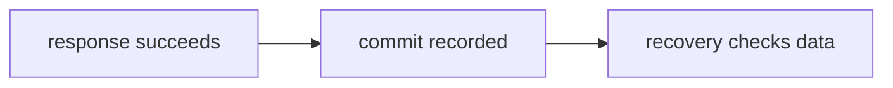

# A08.01 · availability vs durability

[Phase index](../README.md) · [Foundation] · 25–40 minutes

Prerequisite [A07 gate](../../A07-application-integration-arch/README.md#practice-and-exit-gate) · Next [A08.02](A08.02.md)

## 1. The problem & why it exists

A service responds promptly but loses committed data after a restart. Measure response success and restoration correctness separately.

## 2. Visual mental model



```text
01. response succeeds
02. commit recorded
03. recovery checks data
```

Follow the responsibilities in order. The fixture isolates one mechanism. Check the workload and observation point before attributing the result to an actual deployment.

## 3. Step-by-step mechanism & minimal dry-run

Availability is a service-usability property at a defined boundary. Durability is a persistence property under a specified set of faults. You can lose one while preserving the other.

**Trace.** response succeeds → commit recorded → recovery checks data.

## 4. Formal rigor & quantitative math

If 999 of 1000 requests succeed, measured request availability is 99.9%. That ratio does not describe the probability of losing a stored record.

Predict the worked quantities by hand, then run the [example](../examples/A08.01.py). It uses a small calculation or state model. For arithmetic, retain the units attached to the worked formula.

## 5. Progressive design

| Run | Expected fixture result | Interpretation |
| --- | --- | --- |
| Failure control | `999` | Which assumption from the opening problem leads to this result? |
| Normal control | `0.999` | Measure response success and restoration correctness separately. |

When the fixture reports a modeled value, use the lab to check the corresponding workload behavior. Compare work per request, retained bytes, and operational consequences only where the model measures them.

## 6. Safe local lab & controlled failure injection

```sh
uv run python "01-architecture-A01-to-A20/A08-reliability-operations-and-sre/examples/A08.01.py"
uv run python "01-architecture-A01-to-A20/A08-reliability-operations-and-sre/examples/A08.01.py" --break
```

Predict both results and identify which input or branch changes. Rerun the normal control as a repair. In a scratch copy, change one key, bound or assumption and predict the result again. Remove the scratch copy after recording your evidence. Apply this reasoning in [L3](../labs/L3.md).

## 7. Production & multi-cloud bridge

Measure response success and restoration correctness separately. For deployments on AWS, Azure or Google Cloud, confirm quotas, limits and which observations are available at each service boundary. Run production comparisons with the same query mix and recovery objective.

<details>
<summary>Principal question and answer</summary>

What evidence would distinguish the opening failure from a storage-capacity problem? Start with the first divergent boundary in the trace and name the exact mechanism. Availability is a service-usability property at a defined boundary. Durability is a persistence property under a specified set of faults. You can lose one while preserving the other.

</details>

## 8. Memory hook & mastery checkpoint

1. Name the operation at the first stage in the trace.
2. Explain the normal and broken outputs before running them.
3. Change one input and compute the revised result with units.
4. How would you test this boundary at deployment scale?
5. What is one assumption that limits the fixture?

<details>
<summary>Check your reasoning</summary>

1. response succeeds.
2. Normal `0.999`. Failure `999`.
3. Reapply the relationship in section 4 to your changed inputs.
4. Measure response success and restoration correctness separately.
5. The example uses a small calculation or state model. Check the primary reference for behavior outside that scope.

</details>

## Standards and implementation notes

- [Primary reference](https://sre.google/sre-book/service-level-objectives/)
