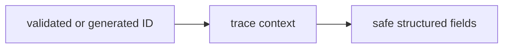

# A08.06 · structured correlation IDs

[Phase index](../README.md) · [Foundation] · 25–40 minutes

Prerequisite [A08.05](A08.05.md) · Next [A08.07](A08.07.md)

## 1. The problem & why it exists

A request ID from an untrusted client leaks tenant data into logs. Keep request identifiers distinct from user identity and from time-series label dimensions.

## 2. Visual mental model



```text
01. validated or generated ID
02. trace context
03. safe structured fields
```

Follow the responsibilities in order. The fixture isolates one mechanism. Check the workload and observation point before attributing the result to an actual deployment.

## 3. Step-by-step mechanism & minimal dry-run

Generate or validate correlation values and propagate them according to interoperability policy. Logs should use allowlisted fields and avoid secrets or high-cardinality metric labels.

**Trace.** validated or generated ID → trace context → safe structured fields.

## 4. Formal rigor & quantitative math

At 500 requests/s, recording one 48-byte identifier per request adds 24000 bytes/s before encoding and transport overhead.

Predict the worked quantities by hand, then run the [example](../examples/A08.06.py). It uses a small calculation or state model. For arithmetic, retain the units attached to the worked formula.

## 5. Progressive design

| Run | Expected fixture result | Interpretation |
| --- | --- | --- |
| Failure control | `500` | Which assumption from the opening problem leads to this result? |
| Normal control | `24000` | Keep request identifiers distinct from user identity and from time-series label dimensions. |

When the fixture reports a modeled value, use the lab to check the corresponding workload behavior. Compare work per request, retained bytes, and operational consequences only where the model measures them.

## 6. Safe local lab & controlled failure injection

```sh
uv run python "01-architecture-A01-to-A20/A08-reliability-operations-and-sre/examples/A08.06.py"
uv run python "01-architecture-A01-to-A20/A08-reliability-operations-and-sre/examples/A08.06.py" --break
```

Predict both results and identify which input or branch changes. Rerun the normal control as a repair. In a scratch copy, change one key, bound or assumption and predict the result again. Remove the scratch copy after recording your evidence. Apply this reasoning in [L1](../labs/L1.md).

## 7. Production & multi-cloud bridge

Keep request identifiers distinct from user identity and from time-series label dimensions. For deployments on AWS, Azure or Google Cloud, confirm quotas, limits and which observations are available at each service boundary. Run production comparisons with the same query mix and recovery objective.

<details>
<summary>Principal question and answer</summary>

What evidence would distinguish the opening failure from a storage-capacity problem? Start with the first divergent boundary in the trace and name the exact mechanism. Generate or validate correlation values and propagate them according to interoperability policy. Logs should use allowlisted fields and avoid secrets or high-cardinality metric labels.

</details>

## 8. Memory hook & mastery checkpoint

1. Name the operation at the first stage in the trace.
2. Explain the normal and broken outputs before running them.
3. Change one input and compute the revised result with units.
4. How would you test this boundary at deployment scale?
5. What is one assumption that limits the fixture?

<details>
<summary>Check your reasoning</summary>

1. validated or generated ID.
2. Normal `24000`. Failure `500`.
3. Reapply the relationship in section 4 to your changed inputs.
4. Keep request identifiers distinct from user identity and from time-series label dimensions.
5. The example uses a small calculation or state model. Check the primary reference for behavior outside that scope.

</details>

## Standards and implementation notes

- [Primary reference](https://www.w3.org/TR/trace-context/)
