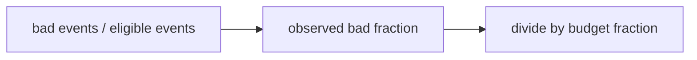

# A08.15 · error budgets

[Phase index](../README.md) · [Core] · 25–40 minutes

Prerequisite [A08.14](A08.14.md) · Next [A08.16](A08.16.md)

## 1. The problem & why it exists

A team sees an error rate but cannot tell whether action is urgent. Use multiple windows and defined volume requirements to avoid noisy alerts.

## 2. Visual mental model



```text
01. bad events / eligible events
02. observed bad fraction
03. divide by budget fraction
```

Follow the responsibilities in order. The fixture isolates one mechanism. Check the workload and observation point before attributing the result to an actual deployment.

## 3. Step-by-step mechanism & minimal dry-run

An error budget is the tolerable bad share under the SLO. Burn rate divides observed bad fraction by the allowed one under matching units.

**Trace.** bad events / eligible events → observed bad fraction → divide by budget fraction.

**Compute the allowance.** For an SLO of 99.9% good over one million eligible requests, the budget is 1000 bad requests. At 500 bad, half the request allowance remains.

**Compute burn over a specified window.** An observed bad share of 1% divided by 0.1% is 10×. A short burst and a sustained long-window burn imply different operator actions. Use a separate eligible denominator in each alert window. The [budget lab](../labs/L2.md) uses exact count arithmetic before converting the ratio for display.

## 4. Formal rigor & quantitative math

At a 99.9% objective, a 1% bad rate burns at 10×. If sustained at stable traffic, it consumes a 30-day budget in three days.

Predict the worked quantities by hand, then run the [example](../examples/A08.15.py). It uses a small calculation or state model. For arithmetic, retain the units attached to the worked formula.

## 5. Progressive design

| Run | Expected fixture result | Interpretation |
| --- | --- | --- |
| Failure control | `0.01` | Which assumption from the opening problem leads to this result? |
| Normal control | `10.0` | Use multiple windows and defined volume requirements to avoid noisy alerts. |

When the fixture reports a modeled value, use the lab to check the corresponding workload behavior. Compare work per request, retained bytes, and operational consequences only where the model measures them.

## 6. Safe local lab & controlled failure injection

```sh
uv run python "01-architecture-A01-to-A20/A08-reliability-operations-and-sre/examples/A08.15.py"
uv run python "01-architecture-A01-to-A20/A08-reliability-operations-and-sre/examples/A08.15.py" --break
```

Predict both results and identify which input or branch changes. Rerun the normal control as a repair. In a scratch copy, change one key, bound or assumption and predict the result again. Remove the scratch copy after recording your evidence. Apply this reasoning in [L2](../labs/L2.md).

## 7. Production & multi-cloud bridge

Use multiple windows and defined volume requirements to avoid noisy alerts. For deployments on AWS, Azure or Google Cloud, confirm quotas, limits and which observations are available at each service boundary. Run production comparisons with the same query mix and recovery objective.

<details>
<summary>Principal question and answer</summary>

What evidence would distinguish the opening failure from a storage-capacity problem? Start with the first divergent boundary in the trace and name the exact mechanism. An error budget is the tolerable bad share under the SLO. Burn rate divides observed bad fraction by the allowed one under matching units.

</details>

## 8. Memory hook & mastery checkpoint

1. Name the operation at the first stage in the trace.
2. Explain the normal and broken outputs before running them.
3. Change one input and compute the revised result with units.
4. How would you test this boundary at deployment scale?
5. What is one assumption that limits the fixture?

<details>
<summary>Check your reasoning</summary>

1. bad events / eligible events.
2. Normal `10.0`. Failure `0.01`.
3. Reapply the relationship in section 4 to your changed inputs.
4. Use multiple windows and defined volume requirements to avoid noisy alerts.
5. The example uses a small calculation or state model. Check the primary reference for behavior outside that scope.

</details>

## Standards and implementation notes

- [Primary reference](https://sre.google/workbook/alerting-on-slos/)
