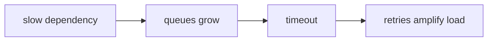

# A08.21 · cascading failures

[Phase index](../README.md) · [Principal] · 25–40 minutes

Prerequisite [A08.20](A08.20.md) · Next [A08.22](A08.22.md)

## 1. The problem & why it exists

One backend slowdown spreads into complete frontend unavailability. Limit queue age and retries, reject excess early, and test dependency degradation.

## 2. Visual mental model



```text
01. slow dependency
02. queues grow
03. timeout
04. retries amplify load
```

Follow the responsibilities in order. The fixture isolates one mechanism. Check the workload and observation point before attributing the result to an actual deployment.

## 3. Step-by-step mechanism & minimal dry-run

Cascades amplify failure through queues, retries, shared pools and load redistribution. Saturated workers reject or time out, producing additional attempts.

**Trace.** slow dependency → queues grow → timeout → retries amplify load.

## 4. Formal rigor & quantitative math

At 100 original requests/s and one retry for every failure, offered downstream work can reach 200 attempts/s in the simple model.

Predict the worked quantities by hand, then run the [example](../examples/A08.21.py). It uses a small calculation or state model. For arithmetic, retain the units attached to the worked formula.

## 5. Progressive design

| Run | Expected fixture result | Interpretation |
| --- | --- | --- |
| Failure control | `100` | Which assumption from the opening problem leads to this result? |
| Normal control | `200` | Limit queue age and retries, reject excess early, and test dependency degradation. |

When the fixture reports a modeled value, use the lab to check the corresponding workload behavior. Compare work per request, retained bytes, and operational consequences only where the model measures them.

## 6. Safe local lab & controlled failure injection

```sh
uv run python "01-architecture-A01-to-A20/A08-reliability-operations-and-sre/examples/A08.21.py"
uv run python "01-architecture-A01-to-A20/A08-reliability-operations-and-sre/examples/A08.21.py" --break
```

Predict both results and identify which input or branch changes. Rerun the normal control as a repair. In a scratch copy, change one key, bound or assumption and predict the result again. Remove the scratch copy after recording your evidence. Apply this reasoning in [L4](../labs/L4.md).

## 7. Production & multi-cloud bridge

Limit queue age and retries, reject excess early, and test dependency degradation. For deployments on AWS, Azure or Google Cloud, confirm quotas, limits and which observations are available at each service boundary. Run production comparisons with the same query mix and recovery objective.

<details>
<summary>Principal question and answer</summary>

What evidence would distinguish the opening failure from a storage-capacity problem? Start with the first divergent boundary in the trace and name the exact mechanism. Cascades amplify failure through queues, retries, shared pools and load redistribution. Saturated workers reject or time out, producing additional attempts.

</details>

## 8. Memory hook & mastery checkpoint

1. Name the operation at the first stage in the trace.
2. Explain the normal and broken outputs before running them.
3. Change one input and compute the revised result with units.
4. How would you test this boundary at deployment scale?
5. What is one assumption that limits the fixture?

<details>
<summary>Check your reasoning</summary>

1. slow dependency.
2. Normal `200`. Failure `100`.
3. Reapply the relationship in section 4 to your changed inputs.
4. Limit queue age and retries, reject excess early, and test dependency degradation.
5. The example uses a small calculation or state model. Check the primary reference for behavior outside that scope.

</details>

## Standards and implementation notes

- [Primary reference](https://sre.google/sre-book/addressing-cascading-failures/)
