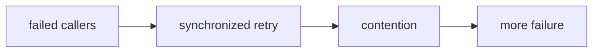

# A08.22 · retry storms

[Phase index](../README.md) · [Principal] · 25–40 minutes

Prerequisite [A08.21](A08.21.md) · Next [A08.23](A08.23.md)

## 1. The problem & why it exists

Recovery traffic exceeds the failed service's available capacity. Bound retries and distribute attempts. Measure the actual arrival histogram rather than assuming uniformity.

## 2. Visual mental model



```text
01. failed callers
02. synchronized retry
03. contention
04. more failure
```

Follow the responsibilities in order. The fixture isolates one mechanism. Check the workload and observation point before attributing the result to an actual deployment.

## 3. Step-by-step mechanism & minimal dry-run

A retry storm is amplified offered load from repeated attempts. Synchronized timers and retries at multiple layers can amplify pressure despite static user traffic.

**Trace.** failed callers → synchronized retry → contention → more failure.

## 4. Formal rigor & quantitative math

With 1000 clients retrying once at the same instant, a 1 s window may get 1000 requests. Uniform jitter over 10 s yields about 100 per 1 s bucket in expectation.

Predict the worked quantities by hand, then run the [example](../examples/A08.22.py). It uses a small calculation or state model. For arithmetic, retain the units attached to the worked formula.

## 5. Progressive design

| Run | Expected fixture result | Interpretation |
| --- | --- | --- |
| Failure control | `1000` | Which assumption from the opening problem leads to this result? |
| Normal control | `100` | Bound retries and distribute attempts. Measure the actual arrival histogram rather than assuming uniformity. |

When the fixture reports a modeled value, use the lab to check the corresponding workload behavior. Compare work per request, retained bytes, and operational consequences only where the model measures them.

## 6. Safe local lab & controlled failure injection

```sh
uv run python "01-architecture-A01-to-A20/A08-reliability-operations-and-sre/examples/A08.22.py"
uv run python "01-architecture-A01-to-A20/A08-reliability-operations-and-sre/examples/A08.22.py" --break
```

Predict both results and identify which input or branch changes. Rerun the normal control as a repair. In a scratch copy, change one key, bound or assumption and predict the result again. Remove the scratch copy after recording your evidence. Apply this reasoning in [L4](../labs/L4.md).

## 7. Production & multi-cloud bridge

Bound retries and distribute attempts. Measure the actual arrival histogram rather than assuming uniformity. For deployments on AWS, Azure or Google Cloud, confirm quotas, limits and which observations are available at each service boundary. Run production comparisons with the same query mix and recovery objective.

<details>
<summary>Principal question and answer</summary>

What evidence would distinguish the opening failure from a storage-capacity problem? Start with the first divergent boundary in the trace and name the exact mechanism. A retry storm is amplified offered load from repeated attempts. Synchronized timers and retries at multiple layers can amplify pressure despite static user traffic.

</details>

## 8. Memory hook & mastery checkpoint

1. Name the operation at the first stage in the trace.
2. Explain the normal and broken outputs before running them.
3. Change one input and compute the revised result with units.
4. How would you test this boundary at deployment scale?
5. What is one assumption that limits the fixture?

<details>
<summary>Check your reasoning</summary>

1. failed callers.
2. Normal `100`. Failure `1000`.
3. Reapply the relationship in section 4 to your changed inputs.
4. Bound retries and distribute attempts. Measure the actual arrival histogram rather than assuming uniformity.
5. The example uses a small calculation or state model. Check the primary reference for behavior outside that scope.

</details>

## Standards and implementation notes

- [Primary reference](https://aws.amazon.com/builders-library/timeouts-retries-and-backoff-with-jitter/)
