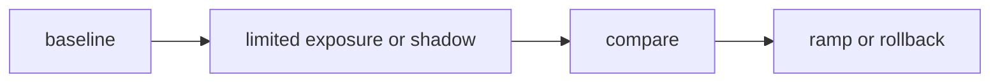

# A08.28 · canary, blue-green and shadow traffic

[Phase index](../README.md) · [Principal] · 25–40 minutes

Prerequisite [A08.27](A08.27.md) · Next [A08.29](A08.29.md)

## 1. The problem & why it exists

A new service serves all users before anyone sees its error rate. Define abort criteria, route cohorts deliberately, and prevent duplicate external effects.

## 2. Visual mental model



```text
01. baseline
02. limited exposure or shadow
03. compare
04. ramp or rollback
```

Follow the responsibilities in order. The fixture isolates one mechanism. Check the workload and observation point before attributing the result to an actual deployment.

## 3. Step-by-step mechanism & minimal dry-run

Canary serves a subset of traffic, blue-green switches between environments, and shadow copies requests without granting authority over user responses. Shadows must isolate side effects.

**Trace.** baseline → limited exposure or shadow → compare → ramp or rollback.

## 4. Formal rigor & quantitative math

A 5% canary at 2000 RPS receives about 100 RPS with even distribution. The small cohort can need more time to see rare errors.

Predict the worked quantities by hand, then run the [example](../examples/A08.28.py). It uses a small calculation or state model. For arithmetic, retain the units attached to the worked formula.

## 5. Progressive design

| Run | Expected fixture result | Interpretation |
| --- | --- | --- |
| Failure control | `2000` | Which assumption from the opening problem leads to this result? |
| Normal control | `100` | Define abort criteria, route cohorts deliberately, and prevent duplicate external effects. |

When the fixture reports a modeled value, use the lab to check the corresponding workload behavior. Compare work per request, retained bytes, and operational consequences only where the model measures them.

## 6. Safe local lab & controlled failure injection

```sh
uv run python "01-architecture-A01-to-A20/A08-reliability-operations-and-sre/examples/A08.28.py"
uv run python "01-architecture-A01-to-A20/A08-reliability-operations-and-sre/examples/A08.28.py" --break
```

Predict both results and identify which input or branch changes. Rerun the normal control as a repair. In a scratch copy, change one key, bound or assumption and predict the result again. Remove the scratch copy after recording your evidence. Apply this reasoning in [L4](../labs/L4.md).

## 7. Production & multi-cloud bridge

Define abort criteria, route cohorts deliberately, and prevent duplicate external effects. For deployments on AWS, Azure or Google Cloud, confirm quotas, limits and which observations are available at each service boundary. Run production comparisons with the same query mix and recovery objective.

<details>
<summary>Principal question and answer</summary>

What evidence would distinguish the opening failure from a storage-capacity problem? Start with the first divergent boundary in the trace and name the exact mechanism. Canary serves a subset of traffic, blue-green switches between environments, and shadow copies requests without granting authority over user responses. Shadows must isolate side effects.

</details>

## 8. Memory hook & mastery checkpoint

1. Name the operation at the first stage in the trace.
2. Explain the normal and broken outputs before running them.
3. Change one input and compute the revised result with units.
4. How would you test this boundary at deployment scale?
5. What is one assumption that limits the fixture?

<details>
<summary>Check your reasoning</summary>

1. baseline.
2. Normal `100`. Failure `2000`.
3. Reapply the relationship in section 4 to your changed inputs.
4. Define abort criteria, route cohorts deliberately, and prevent duplicate external effects.
5. The example uses a small calculation or state model. Check the primary reference for behavior outside that scope.

</details>

## Standards and implementation notes

- [Primary reference](https://sre.google/workbook/canarying-releases/)
