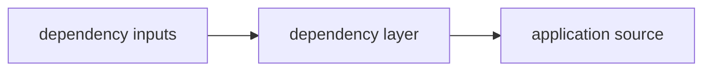

# A09.04 · Dockerfile layers and cache

[Phase index](../README.md) · [Foundation] · 25–40 minutes

Prerequisite [A09.03](A09.03.md) · Next [A09.05](A09.05.md)

## 1. The problem & why it exists

A dependency install reruns on every source edit. Layer stable dependencies separately and keep context small. Verify cache behavior with two representative builds.

## 2. Visual mental model



```text
01. dependency inputs
02. dependency layer
03. application source
```

Follow the responsibilities in order. The fixture isolates one mechanism. Check the workload and observation point before attributing the result to an actual deployment.

## 3. Step-by-step mechanism & minimal dry-run

Docker reuses cached build decisions when the relevant instructions and inputs stay compatible. Copying rapidly changing source before dependency preparation can invalidate that work.

**Trace.** dependency inputs → dependency layer → application source.

## 4. Formal rigor & quantitative math

At 20 source-only changes and 15 s installs, misplaced copies cost up to 300 s in the simple model.

Predict the worked quantities by hand, then run the [example](../examples/A09.04.py). It uses a small calculation or state model. For arithmetic, retain the units attached to the worked formula.

## 5. Progressive design

| Run | Expected fixture result | Interpretation |
| --- | --- | --- |
| Failure control | `300` | Which assumption from the opening problem leads to this result? |
| Normal control | `0` | Layer stable dependencies separately and keep context small. Verify cache behavior with two representative builds. |

When the fixture reports a modeled value, use the lab to check the corresponding workload behavior. Compare work per request, retained bytes, and operational consequences only where the model measures them.

## 6. Safe local lab & controlled failure injection

```sh
uv run python "01-architecture-A01-to-A20/A09-cloud-containers-k8s-devsecops/examples/A09.04.py"
uv run python "01-architecture-A01-to-A20/A09-cloud-containers-k8s-devsecops/examples/A09.04.py" --break
```

Predict both results and identify which input or branch changes. Rerun the normal control as a repair. In a scratch copy, change one key, bound or assumption and predict the result again. Remove the scratch copy after recording your evidence. Apply this reasoning in [L1](../labs/L1.md).

## 7. Production & multi-cloud bridge

Layer stable dependencies separately and keep context small. Verify cache behavior with two representative builds. For deployments on AWS, Azure or Google Cloud, confirm quotas, limits and which observations are available at each service boundary. Run production comparisons with the same query mix and recovery objective.

<details>
<summary>Principal question and answer</summary>

What evidence would distinguish the opening failure from a storage-capacity problem? Start with the first divergent boundary in the trace and name the exact mechanism. Docker reuses cached build decisions when the relevant instructions and inputs stay compatible. Copying rapidly changing source before dependency preparation can invalidate that work.

</details>

## 8. Memory hook & mastery checkpoint

1. Name the operation at the first stage in the trace.
2. Explain the normal and broken outputs before running them.
3. Change one input and compute the revised result with units.
4. How would you test this boundary at deployment scale?
5. What is one assumption that limits the fixture?

<details>
<summary>Check your reasoning</summary>

1. dependency inputs.
2. Normal `0`. Failure `300`.
3. Reapply the relationship in section 4 to your changed inputs.
4. Layer stable dependencies separately and keep context small. Verify cache behavior with two representative builds.
5. The example uses a small calculation or state model. Check the primary reference for behavior outside that scope.

</details>

## Standards and implementation notes

- [Primary reference](https://docs.docker.com/build/cache/)
