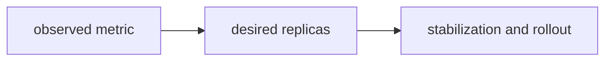

# A09.19 · HPA

[Phase index](../README.md) · [Core] · 25–40 minutes

Prerequisite [A09.18](A09.18.md) · Next [A09.20](A09.20.md)

## 1. The problem & why it exists

The autoscaler changes replica count even when the underlying bottleneck is fixed. Use metrics aligned to the actual bottleneck and account for queue, startup and downstream limits.

## 2. Visual mental model



```text
01. observed metric
02. desired replicas
03. stabilization and rollout
```

Follow the responsibilities in order. The fixture isolates one mechanism. Check the workload and observation point before attributing the result to an actual deployment.

## 3. Step-by-step mechanism & minimal dry-run

HPA uses metrics and configured targets with control-loop behavior. Resource utilization can depend on requested values. Scaling Pods does not create downstream capacity.

**Trace.** observed metric → desired replicas → stabilization and rollout.

## 4. Formal rigor & quantitative math

With four replicas, observed utilization 80% and target 50%, ceil(4×80/50)=7 before tolerance and safeguards.

Predict the worked quantities by hand, then run the [example](../examples/A09.19.py). It uses a small calculation or state model. For arithmetic, retain the units attached to the worked formula.

## 5. Progressive design

| Run | Expected fixture result | Interpretation |
| --- | --- | --- |
| Failure control | `4` | Which assumption from the opening problem leads to this result? |
| Normal control | `7` | Use metrics aligned to the actual bottleneck and account for queue, startup and downstream limits. |

When the fixture reports a modeled value, use the lab to check the corresponding workload behavior. Compare work per request, retained bytes, and operational consequences only where the model measures them.

## 6. Safe local lab & controlled failure injection

```sh
uv run python "01-architecture-A01-to-A20/A09-cloud-containers-k8s-devsecops/examples/A09.19.py"
uv run python "01-architecture-A01-to-A20/A09-cloud-containers-k8s-devsecops/examples/A09.19.py" --break
```

Predict both results and identify which input or branch changes. Rerun the normal control as a repair. In a scratch copy, change one key, bound or assumption and predict the result again. Remove the scratch copy after recording your evidence. Apply this reasoning in [L2](../labs/L2.md).

## 7. Production & multi-cloud bridge

Use metrics aligned to the actual bottleneck and account for queue, startup and downstream limits. For deployments on AWS, Azure or Google Cloud, confirm quotas, limits and which observations are available at each service boundary. Run production comparisons with the same query mix and recovery objective.

<details>
<summary>Principal question and answer</summary>

What evidence would distinguish the opening failure from a storage-capacity problem? Start with the first divergent boundary in the trace and name the exact mechanism. HPA uses metrics and configured targets with control-loop behavior. Resource utilization can depend on requested values. Scaling Pods does not create downstream capacity.

</details>

## 8. Memory hook & mastery checkpoint

1. Name the operation at the first stage in the trace.
2. Explain the normal and broken outputs before running them.
3. Change one input and compute the revised result with units.
4. How would you test this boundary at deployment scale?
5. What is one assumption that limits the fixture?

<details>
<summary>Check your reasoning</summary>

1. observed metric.
2. Normal `7`. Failure `4`.
3. Reapply the relationship in section 4 to your changed inputs.
4. Use metrics aligned to the actual bottleneck and account for queue, startup and downstream limits.
5. The example uses a small calculation or state model. Check the primary reference for behavior outside that scope.

</details>

## Standards and implementation notes

- [Primary reference](https://kubernetes.io/docs/tasks/run-application/horizontal-pod-autoscale/)
