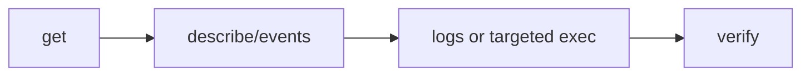

# A09.22 · CKAD workflows and debugging

[Phase index](../README.md) · [Principal] · 25–40 minutes

Prerequisite [A09.21](A09.21.md) · Next [A09.23](A09.23.md)

## 1. The problem & why it exists

A learner restarts Pods before finding why they are pending. Use read-only evidence before changing the system and reproduce fixes on a disposable cluster.

## 2. Visual mental model



```text
01. get
02. describe/events
03. logs or targeted exec
04. verify
```

Follow the responsibilities in order. The fixture isolates one mechanism. Check the workload and observation point before attributing the result to an actual deployment.

## 3. Step-by-step mechanism & minimal dry-run

Troubleshooting begins with desired state, events, controller status and logs. Scheduling failures and crashing containers need different evidence.

**Trace.** get → describe/events → logs or targeted exec → verify.

## 4. Formal rigor & quantitative math

A Deployment asking for two replicas but reporting zero scheduled exposes two unplaced replicas; raising application timeouts does not schedule them.

Predict the worked quantities by hand, then run the [example](../examples/A09.22.py). It uses a small calculation or state model. For arithmetic, retain the units attached to the worked formula.

## 5. Progressive design

| Run | Expected fixture result | Interpretation |
| --- | --- | --- |
| Failure control | `0` | Which assumption from the opening problem leads to this result? |
| Normal control | `2` | Use read-only evidence before changing the system and reproduce fixes on a disposable cluster. |

When the fixture reports a modeled value, use the lab to check the corresponding workload behavior. Compare work per request, retained bytes, and operational consequences only where the model measures them.

## 6. Safe local lab & controlled failure injection

```sh
uv run python "01-architecture-A01-to-A20/A09-cloud-containers-k8s-devsecops/examples/A09.22.py"
uv run python "01-architecture-A01-to-A20/A09-cloud-containers-k8s-devsecops/examples/A09.22.py" --break
```

Predict both results and identify which input or branch changes. Rerun the normal control as a repair. In a scratch copy, change one key, bound or assumption and predict the result again. Remove the scratch copy after recording your evidence. Apply this reasoning in [L2](../labs/L2.md).

## 7. Production & multi-cloud bridge

Use read-only evidence before changing the system and reproduce fixes on a disposable cluster. For deployments on AWS, Azure or Google Cloud, confirm quotas, limits and which observations are available at each service boundary. Run production comparisons with the same query mix and recovery objective.

<details>
<summary>Principal question and answer</summary>

What evidence would distinguish the opening failure from a storage-capacity problem? Start with the first divergent boundary in the trace and name the exact mechanism. Troubleshooting begins with desired state, events, controller status and logs. Scheduling failures and crashing containers need different evidence.

</details>

## 8. Memory hook & mastery checkpoint

1. Name the operation at the first stage in the trace.
2. Explain the normal and broken outputs before running them.
3. Change one input and compute the revised result with units.
4. How would you test this boundary at deployment scale?
5. What is one assumption that limits the fixture?

<details>
<summary>Check your reasoning</summary>

1. get.
2. Normal `2`. Failure `0`.
3. Reapply the relationship in section 4 to your changed inputs.
4. Use read-only evidence before changing the system and reproduce fixes on a disposable cluster.
5. The example uses a small calculation or state model. Check the primary reference for behavior outside that scope.

</details>

## Standards and implementation notes

- [Primary reference](https://kubernetes.io/docs/tasks/debug/debug-application/)
