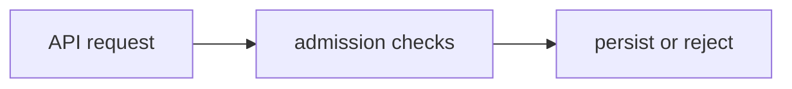

# A09.29 · admission controls

[Phase index](../README.md) · [Principal] · 25–40 minutes

Prerequisite [A09.28](A09.28.md) · Next [A09.30](A09.30.md)

## 1. The problem & why it exists

A risky workload reaches scheduling because policy was checked only in code review. Test policies with one good and one bad dry-run. Plan exception ownership and impact.

## 2. Visual mental model



```text
01. API request
02. admission checks
03. persist or reject
```

Follow the responsibilities in order. The fixture isolates one mechanism. Check the workload and observation point before attributing the result to an actual deployment.

## 3. Step-by-step mechanism & minimal dry-run

Admission checks an API request before persistence and scheduling. Some controllers mutate requests; validating policy rejects invalid state. Audit existing objects separately.

**Trace.** API request → admission checks → persist or reject.

## 4. Formal rigor & quantitative math

If one of five workloads violates a relevant rule, enforcing it can reject that one request while accepting four modeled valid requests.

Predict the worked quantities by hand, then run the [example](../examples/A09.29.py). It uses a small calculation or state model. For arithmetic, retain the units attached to the worked formula.

## 5. Progressive design

| Run | Expected fixture result | Interpretation |
| --- | --- | --- |
| Failure control | `5` | Which assumption from the opening problem leads to this result? |
| Normal control | `4` | Test policies with one good and one bad dry-run. Plan exception ownership and impact. |

When the fixture reports a modeled value, use the lab to check the corresponding workload behavior. Compare work per request, retained bytes, and operational consequences only where the model measures them.

## 6. Safe local lab & controlled failure injection

```sh
uv run python "01-architecture-A01-to-A20/A09-cloud-containers-k8s-devsecops/examples/A09.29.py"
uv run python "01-architecture-A01-to-A20/A09-cloud-containers-k8s-devsecops/examples/A09.29.py" --break
```

Predict both results and identify which input or branch changes. Rerun the normal control as a repair. In a scratch copy, change one key, bound or assumption and predict the result again. Remove the scratch copy after recording your evidence. Apply this reasoning in [L4](../labs/L4.md).

## 7. Production & multi-cloud bridge

Test policies with one good and one bad dry-run. Plan exception ownership and impact. For deployments on AWS, Azure or Google Cloud, confirm quotas, limits and which observations are available at each service boundary. Run production comparisons with the same query mix and recovery objective.

<details>
<summary>Principal question and answer</summary>

What evidence would distinguish the opening failure from a storage-capacity problem? Start with the first divergent boundary in the trace and name the exact mechanism. Admission checks an API request before persistence and scheduling. Some controllers mutate requests; validating policy rejects invalid state. Audit existing objects separately.

</details>

## 8. Memory hook & mastery checkpoint

1. Name the operation at the first stage in the trace.
2. Explain the normal and broken outputs before running them.
3. Change one input and compute the revised result with units.
4. How would you test this boundary at deployment scale?
5. What is one assumption that limits the fixture?

<details>
<summary>Check your reasoning</summary>

1. API request.
2. Normal `4`. Failure `5`.
3. Reapply the relationship in section 4 to your changed inputs.
4. Test policies with one good and one bad dry-run. Plan exception ownership and impact.
5. The example uses a small calculation or state model. Check the primary reference for behavior outside that scope.

</details>

## Standards and implementation notes

- [Primary reference](https://kubernetes.io/docs/concepts/security/pod-security-admission/)
