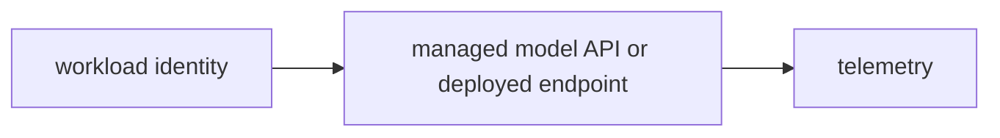

# A09.32 · AWS Bedrock/SageMaker integration

[Phase index](../README.md) · [Principal] · 25–40 minutes

Prerequisite [A09.31](A09.31.md) · Next [A09.33](A09.33.md)

## 1. The problem & why it exists

A workload treats a hosted foundation-model API and a deployed model endpoint as interchangeable. Choose the integration by model control, operating responsibilities and access policy. Use mocked calls for the local exercise.

## 2. Visual mental model



```text
01. workload identity
02. managed model API or deployed endpoint
03. telemetry
```

Follow the responsibilities in order. The fixture isolates one mechanism. Check the workload and observation point before attributing the result to an actual deployment.

## 3. Step-by-step mechanism & minimal dry-run

Amazon Bedrock and SageMaker provide distinct model access and deployment workflows. Both require deliberate authentication, regional support, connectivity, timeout and cost planning.

**Trace.** workload identity → managed model API or deployed endpoint → telemetry.

## 4. Formal rigor & quantitative math

With 100 requests each using 500 input and 200 output tokens, total input is 50000 and output is 20000 tokens. Cost requires actual provider meters.

Predict the worked quantities by hand, then run the [example](../examples/A09.32.py). It uses a small calculation or state model. For arithmetic, retain the units attached to the worked formula.

## 5. Progressive design

| Run | Expected fixture result | Interpretation |
| --- | --- | --- |
| Failure control | `700` | Which assumption from the opening problem leads to this result? |
| Normal control | `70000` | Choose the integration by model control, operating responsibilities and access policy. Use mocked calls for the local exercise. |

When the fixture reports a modeled value, use the lab to check the corresponding workload behavior. Compare work per request, retained bytes, and operational consequences only where the model measures them.

## 6. Safe local lab & controlled failure injection

```sh
uv run python "01-architecture-A01-to-A20/A09-cloud-containers-k8s-devsecops/examples/A09.32.py"
uv run python "01-architecture-A01-to-A20/A09-cloud-containers-k8s-devsecops/examples/A09.32.py" --break
```

Predict both results and identify which input or branch changes. Rerun the normal control as a repair. In a scratch copy, change one key, bound or assumption and predict the result again. Remove the scratch copy after recording your evidence. Apply this reasoning in [L4](../labs/L4.md).

## 7. Production & multi-cloud bridge

Choose the integration by model control, operating responsibilities and access policy. Use mocked calls for the local exercise. For deployments on AWS, Azure or Google Cloud, confirm quotas, limits and which observations are available at each service boundary. Run production comparisons with the same query mix and recovery objective.

<details>
<summary>Principal question and answer</summary>

What evidence would distinguish the opening failure from a storage-capacity problem? Start with the first divergent boundary in the trace and name the exact mechanism. Amazon Bedrock and SageMaker provide distinct model access and deployment workflows. Both require deliberate authentication, regional support, connectivity, timeout and cost planning.

</details>

## 8. Memory hook & mastery checkpoint

1. Name the operation at the first stage in the trace.
2. Explain the normal and broken outputs before running them.
3. Change one input and compute the revised result with units.
4. How would you test this boundary at deployment scale?
5. What is one assumption that limits the fixture?

<details>
<summary>Check your reasoning</summary>

1. workload identity.
2. Normal `70000`. Failure `700`.
3. Reapply the relationship in section 4 to your changed inputs.
4. Choose the integration by model control, operating responsibilities and access policy. Use mocked calls for the local exercise.
5. The example uses a small calculation or state model. Check the primary reference for behavior outside that scope.

</details>

## Standards and implementation notes

- [Primary reference](https://docs.aws.amazon.com/bedrock/latest/userguide/what-is-bedrock.html)
