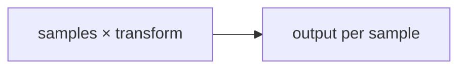

# A10.02 · vectors/matrices

[Phase index](../README.md) · [Foundation] · 25–40 minutes

Prerequisite [A10.01](A10.01.md) · Next [A10.03](A10.03.md)

## 1. The problem & why it exists

A batch multiplication drops the sample axis. Write shapes beside each operand and test single-sample batches.

## 2. Visual mental model



```text
01. samples × transform
02. output per sample
```

Follow the responsibilities in order. The fixture isolates one mechanism. Check the workload and observation point before attributing the result to an actual deployment.

## 3. Step-by-step mechanism & minimal dry-run

Vectors encode coordinates. A matrix maps vectors to other spaces; an (n,d) matrix of samples times a (d,k) transform yields (n,k).

**Trace.** samples × transform → output per sample.

## 4. Formal rigor & quantitative math

A (4,3) matrix times (3,2) gives (4,2), with 4×3×2 scalar multiplications in the direct algorithm.

Predict the worked quantities by hand, then run the [example](../examples/A10.02.py). It uses a small calculation or state model. For arithmetic, retain the units attached to the worked formula.

## 5. Progressive design

| Run | Expected fixture result | Interpretation |
| --- | --- | --- |
| Failure control | `(3, 2)` | Which assumption from the opening problem leads to this result? |
| Normal control | `(4, 2)` | Write shapes beside each operand and test single-sample batches. |

When the fixture reports a modeled value, use the lab to check the corresponding workload behavior. Compare work per request, retained bytes, and operational consequences only where the model measures them.

## 6. Safe local lab & controlled failure injection

```sh
uv run python "01-architecture-A01-to-A20/A10-ml-foundations-math-and-mlops/examples/A10.02.py"
uv run python "01-architecture-A01-to-A20/A10-ml-foundations-math-and-mlops/examples/A10.02.py" --break
```

Predict both results and identify which input or branch changes. Rerun the normal control as a repair. In a scratch copy, change one key, bound or assumption and predict the result again. Remove the scratch copy after recording your evidence. Apply this reasoning in [L1](../labs/L1.md).

## 7. Production & multi-cloud bridge

Write shapes beside each operand and test single-sample batches. For deployments on AWS, Azure or Google Cloud, confirm quotas, limits and which observations are available at each service boundary. Run production comparisons with the same query mix and recovery objective.

<details>
<summary>Principal question and answer</summary>

What evidence would distinguish the opening failure from a storage-capacity problem? Start with the first divergent boundary in the trace and name the exact mechanism. Vectors encode coordinates. A matrix maps vectors to other spaces; an (n,d) matrix of samples times a (d,k) transform yields (n,k).

</details>

## 8. Memory hook & mastery checkpoint

1. Name the operation at the first stage in the trace.
2. Explain the normal and broken outputs before running them.
3. Change one input and compute the revised result with units.
4. How would you test this boundary at deployment scale?
5. What is one assumption that limits the fixture?

<details>
<summary>Check your reasoning</summary>

1. samples × transform.
2. Normal `(4, 2)`. Failure `(3, 2)`.
3. Reapply the relationship in section 4 to your changed inputs.
4. Write shapes beside each operand and test single-sample batches.
5. The example uses a small calculation or state model. Check the primary reference for behavior outside that scope.

</details>

## Standards and implementation notes

- [Primary reference](https://numpy.org/doc/stable/reference/routines.linalg.html)
