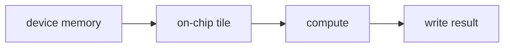

# A11.15 · GPU memory hierarchy

[Phase index](../README.md) · [Core] · 25–40 minutes

Prerequisite [A11.14](A11.14.md) · Next [A11.16](A11.16.md)

## 1. The problem & why it exists

A compute-heavy operation turns out to be limited by memory traffic. Inspect traffic and kernel utilization on the target rather than reading peak specs alone.

## 2. Visual mental model



```text
01. device memory
02. on-chip tile
03. compute
04. write result
```

Follow the responsibilities in order. The fixture isolates one mechanism. Check the workload and observation point before attributing the result to an actual deployment.

## 3. Step-by-step mechanism & minimal dry-run

GPU registers, shared memory, caches and device memory differ in latency and scope. Memory bandwidth can limit work before peak compute is reached.

**Trace.** device memory → on-chip tile → compute → write result.

## 4. Formal rigor & quantitative math

Moving 1 GB at 500 GB/s has an ideal transfer floor of 2 ms, without latency or compute.

Predict the worked quantities by hand, then run the [example](../examples/A11.15.py). It uses a small calculation or state model. For arithmetic, retain the units attached to the worked formula.

## 5. Progressive design

| Run | Expected fixture result | Interpretation |
| --- | --- | --- |
| Failure control | `500` | Which assumption from the opening problem leads to this result? |
| Normal control | `2.0` | Inspect traffic and kernel utilization on the target rather than reading peak specs alone. |

When the fixture reports a modeled value, use the lab to check the corresponding workload behavior. Compare work per request, retained bytes, and operational consequences only where the model measures them.

## 6. Safe local lab & controlled failure injection

```sh
uv run python "01-architecture-A01-to-A20/A11-transformers-llm-internals/examples/A11.15.py"
uv run python "01-architecture-A01-to-A20/A11-transformers-llm-internals/examples/A11.15.py" --break
```

Predict both results and identify which input or branch changes. Rerun the normal control as a repair. In a scratch copy, change one key, bound or assumption and predict the result again. Remove the scratch copy after recording your evidence. Apply this reasoning in [L2](../labs/L2.md).

## 7. Production & multi-cloud bridge

Inspect traffic and kernel utilization on the target rather than reading peak specs alone. For deployments on AWS, Azure or Google Cloud, confirm quotas, limits and which observations are available at each service boundary. Run production comparisons with the same query mix and recovery objective.

<details>
<summary>Principal question and answer</summary>

What evidence would distinguish the opening failure from a storage-capacity problem? Start with the first divergent boundary in the trace and name the exact mechanism. GPU registers, shared memory, caches and device memory differ in latency and scope. Memory bandwidth can limit work before peak compute is reached.

</details>

## 8. Memory hook & mastery checkpoint

1. Name the operation at the first stage in the trace.
2. Explain the normal and broken outputs before running them.
3. Change one input and compute the revised result with units.
4. How would you test this boundary at deployment scale?
5. What is one assumption that limits the fixture?

<details>
<summary>Check your reasoning</summary>

1. device memory.
2. Normal `2.0`. Failure `500`.
3. Reapply the relationship in section 4 to your changed inputs.
4. Inspect traffic and kernel utilization on the target rather than reading peak specs alone.
5. The example uses a small calculation or state model. Check the primary reference for behavior outside that scope.

</details>

## Standards and implementation notes

- [Primary reference](https://docs.nvidia.com/cuda/cuda-c-programming-guide/)
