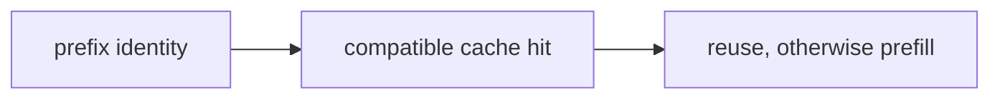

# A11.23 · prefix caching

[Phase index](../README.md) · [Core] · 25–40 minutes

Prerequisite [A11.22](A11.22.md) · Next [A11.24](A11.24.md)

## 1. The problem & why it exists

Similar prompts reuse bytes that were computed under a different model revision. Key by correctness and authority scope, and test invalidation and accounting for shared blocks.

## 2. Visual mental model



```text
01. prefix identity
02. compatible cache hit
03. reuse, otherwise prefill
```

Follow the responsibilities in order. The fixture isolates one mechanism. Check the workload and observation point before attributing the result to an actual deployment.

## 3. Step-by-step mechanism & minimal dry-run

Prefix caching can share compatible preceding-token computations. Identity depends on exact token sequence and compatible model/runtime context; isolate tenants where needed.

**Trace.** prefix identity → compatible cache hit → reuse, otherwise prefill.

## 4. Formal rigor & quantitative math

A 400-token reused prefix in a 500-token prompt leaves 100 new prompt tokens to process under the simple model.

Predict the worked quantities by hand, then run the [example](../examples/A11.23.py). It uses a small calculation or state model. For arithmetic, retain the units attached to the worked formula.

## 5. Progressive design

| Run | Expected fixture result | Interpretation |
| --- | --- | --- |
| Failure control | `500` | Which assumption from the opening problem leads to this result? |
| Normal control | `100` | Key by correctness and authority scope, and test invalidation and accounting for shared blocks. |

When the fixture reports a modeled value, use the lab to check the corresponding workload behavior. Compare work per request, retained bytes, and operational consequences only where the model measures them.

## 6. Safe local lab & controlled failure injection

```sh
uv run python "01-architecture-A01-to-A20/A11-transformers-llm-internals/examples/A11.23.py"
uv run python "01-architecture-A01-to-A20/A11-transformers-llm-internals/examples/A11.23.py" --break
```

Predict both results and identify which input or branch changes. Rerun the normal control as a repair. In a scratch copy, change one key, bound or assumption and predict the result again. Remove the scratch copy after recording your evidence. Apply this reasoning in [L3](../labs/L3.md).

## 7. Production & multi-cloud bridge

Key by correctness and authority scope, and test invalidation and accounting for shared blocks. For deployments on AWS, Azure or Google Cloud, confirm quotas, limits and which observations are available at each service boundary. Run production comparisons with the same query mix and recovery objective.

<details>
<summary>Principal question and answer</summary>

What evidence would distinguish the opening failure from a storage-capacity problem? Start with the first divergent boundary in the trace and name the exact mechanism. Prefix caching can share compatible preceding-token computations. Identity depends on exact token sequence and compatible model/runtime context; isolate tenants where needed.

</details>

## 8. Memory hook & mastery checkpoint

1. Name the operation at the first stage in the trace.
2. Explain the normal and broken outputs before running them.
3. Change one input and compute the revised result with units.
4. How would you test this boundary at deployment scale?
5. What is one assumption that limits the fixture?

<details>
<summary>Check your reasoning</summary>

1. prefix identity.
2. Normal `100`. Failure `500`.
3. Reapply the relationship in section 4 to your changed inputs.
4. Key by correctness and authority scope, and test invalidation and accounting for shared blocks.
5. The example uses a small calculation or state model. Check the primary reference for behavior outside that scope.

</details>

## Standards and implementation notes

- [Primary reference](https://docs.vllm.ai/en/latest/)
