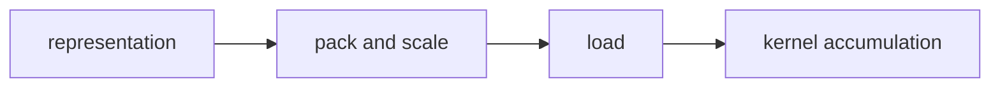

# A11.25 · BF16/FP8/INT8/4-bit formats

[Phase index](../README.md) · [Principal] · 25–40 minutes

Prerequisite [A11.24](A11.24.md) · Next [A11.26](A11.26.md)

## 1. The problem & why it exists

Processing precision and storage precision are assumed identical. Benchmark exact format, kernels, quality and shape instead of assuming speed from bit width.

## 2. Visual mental model



```text
01. representation
02. pack and scale
03. load
04. kernel accumulation
```

Follow the responsibilities in order. The fixture isolates one mechanism. Check the workload and observation point before attributing the result to an actual deployment.

## 3. Step-by-step mechanism & minimal dry-run

BF16, FP8 and integer formats differ in representation and kernel support. Four-bit weights commonly have scaling metadata and wider compute or accumulation.

**Trace.** representation → pack and scale → load → kernel accumulation.

## 4. Formal rigor & quantitative math

Eight billion weights at four bits are 4 GB raw decimal before scales, metadata and runtime memory.

Predict the worked quantities by hand, then run the [example](../examples/A11.25.py). It uses a small calculation or state model. For arithmetic, retain the units attached to the worked formula.

## 5. Progressive design

| Run | Expected fixture result | Interpretation |
| --- | --- | --- |
| Failure control | `8000000000` | Which assumption from the opening problem leads to this result? |
| Normal control | `4000000000` | Benchmark exact format, kernels, quality and shape instead of assuming speed from bit width. |

When the fixture reports a modeled value, use the lab to check the corresponding workload behavior. Compare work per request, retained bytes, and operational consequences only where the model measures them.

## 6. Safe local lab & controlled failure injection

```sh
uv run python "01-architecture-A01-to-A20/A11-transformers-llm-internals/examples/A11.25.py"
uv run python "01-architecture-A01-to-A20/A11-transformers-llm-internals/examples/A11.25.py" --break
```

Predict both results and identify which input or branch changes. Rerun the normal control as a repair. In a scratch copy, change one key, bound or assumption and predict the result again. Remove the scratch copy after recording your evidence. Apply this reasoning in [L3](../labs/L3.md).

## 7. Production & multi-cloud bridge

Benchmark exact format, kernels, quality and shape instead of assuming speed from bit width. For deployments on AWS, Azure or Google Cloud, confirm quotas, limits and which observations are available at each service boundary. Run production comparisons with the same query mix and recovery objective.

<details>
<summary>Principal question and answer</summary>

What evidence would distinguish the opening failure from a storage-capacity problem? Start with the first divergent boundary in the trace and name the exact mechanism. BF16, FP8 and integer formats differ in representation and kernel support. Four-bit weights commonly have scaling metadata and wider compute or accumulation.

</details>

## 8. Memory hook & mastery checkpoint

1. Name the operation at the first stage in the trace.
2. Explain the normal and broken outputs before running them.
3. Change one input and compute the revised result with units.
4. How would you test this boundary at deployment scale?
5. What is one assumption that limits the fixture?

<details>
<summary>Check your reasoning</summary>

1. representation.
2. Normal `4000000000`. Failure `8000000000`.
3. Reapply the relationship in section 4 to your changed inputs.
4. Benchmark exact format, kernels, quality and shape instead of assuming speed from bit width.
5. The example uses a small calculation or state model. Check the primary reference for behavior outside that scope.

</details>

## Standards and implementation notes

- [Primary reference](https://docs.pytorch.org/docs/stable/nn.html)
