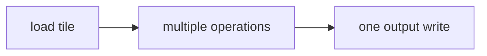

# A11.30 · Triton and kernel fusion

[Phase index](../README.md) · [Principal] · 25–40 minutes

Prerequisite [A11.29](A11.29.md) · Next [A11.31](A11.31.md)

## 1. The problem & why it exists

Many small kernels spend time on launches and intermediate transfers. Validate correctness against an unfused implementation and profile representative inputs.

## 2. Visual mental model



```text
01. load tile
02. multiple operations
03. one output write
```

Follow the responsibilities in order. The fixture isolates one mechanism. Check the workload and observation point before attributing the result to an actual deployment.

## 3. Step-by-step mechanism & minimal dry-run

Fusion can combine compatible operations in one kernel; Triton exposes a programming model for tiled GPU operations. Fusion can trade lower traffic for higher register usage or compilation complexity.

**Trace.** load tile → multiple operations → one output write.

## 4. Formal rigor & quantitative math

Two elementwise stages writing one full intermediate each can save one intermediate write and read when safely fused.

Predict the worked quantities by hand, then run the [example](../examples/A11.30.py). It uses a small calculation or state model. For arithmetic, retain the units attached to the worked formula.

## 5. Progressive design

| Run | Expected fixture result | Interpretation |
| --- | --- | --- |
| Failure control | `2` | Which assumption from the opening problem leads to this result? |
| Normal control | `1` | Validate correctness against an unfused implementation and profile representative inputs. |

When the fixture reports a modeled value, use the lab to check the corresponding workload behavior. Compare work per request, retained bytes, and operational consequences only where the model measures them.

## 6. Safe local lab & controlled failure injection

```sh
uv run python "01-architecture-A01-to-A20/A11-transformers-llm-internals/examples/A11.30.py"
uv run python "01-architecture-A01-to-A20/A11-transformers-llm-internals/examples/A11.30.py" --break
```

Predict both results and identify which input or branch changes. Rerun the normal control as a repair. In a scratch copy, change one key, bound or assumption and predict the result again. Remove the scratch copy after recording your evidence. Apply this reasoning in [L3](../labs/L3.md).

## 7. Production & multi-cloud bridge

Validate correctness against an unfused implementation and profile representative inputs. For deployments on AWS, Azure or Google Cloud, confirm quotas, limits and which observations are available at each service boundary. Run production comparisons with the same query mix and recovery objective.

<details>
<summary>Principal question and answer</summary>

What evidence would distinguish the opening failure from a storage-capacity problem? Start with the first divergent boundary in the trace and name the exact mechanism. Fusion can combine compatible operations in one kernel; Triton exposes a programming model for tiled GPU operations. Fusion can trade lower traffic for higher register usage or compilation complexity.

</details>

## 8. Memory hook & mastery checkpoint

1. Name the operation at the first stage in the trace.
2. Explain the normal and broken outputs before running them.
3. Change one input and compute the revised result with units.
4. How would you test this boundary at deployment scale?
5. What is one assumption that limits the fixture?

<details>
<summary>Check your reasoning</summary>

1. load tile.
2. Normal `1`. Failure `2`.
3. Reapply the relationship in section 4 to your changed inputs.
4. Validate correctness against an unfused implementation and profile representative inputs.
5. The example uses a small calculation or state model. Check the primary reference for behavior outside that scope.

</details>

## Standards and implementation notes

- [Primary reference](https://triton-lang.org/main/index.html)
