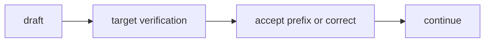

# A11.32 · speculative decoding

[Phase index](../README.md) · [Principal] · 25–40 minutes

Prerequisite [A11.31](A11.31.md) · Next [A11.33](A11.33.md)

## 1. The problem & why it exists

A draft model proposes tokens that the target model would not produce. Measure acceptance, latency, and target output agreement under explicit semantics.

## 2. Visual mental model



```text
01. draft
02. target verification
03. accept prefix or correct
04. continue
```

Follow the responsibilities in order. The fixture isolates one mechanism. Check the workload and observation point before attributing the result to an actual deployment.

## 3. Step-by-step mechanism & minimal dry-run

Speculative decoding proposes multiple tokens and verifies them with the target model. Distribution-preserving algorithms need the corresponding acceptance and correction steps.

**Trace.** draft → target verification → accept prefix or correct → continue.

## 4. Formal rigor & quantitative math

If five proposed tokens yield three accepted draft tokens, observed acceptance is 60%. Speed depends on draft and target costs too.

Predict the worked quantities by hand, then run the [example](../examples/A11.32.py). It uses a small calculation or state model. For arithmetic, retain the units attached to the worked formula.

## 5. Progressive design

| Run | Expected fixture result | Interpretation |
| --- | --- | --- |
| Failure control | `5` | Which assumption from the opening problem leads to this result? |
| Normal control | `0.6` | Measure acceptance, latency, and target output agreement under explicit semantics. |

When the fixture reports a modeled value, use the lab to check the corresponding workload behavior. Compare work per request, retained bytes, and operational consequences only where the model measures them.

## 6. Safe local lab & controlled failure injection

```sh
uv run python "01-architecture-A01-to-A20/A11-transformers-llm-internals/examples/A11.32.py"
uv run python "01-architecture-A01-to-A20/A11-transformers-llm-internals/examples/A11.32.py" --break
```

Predict both results and identify which input or branch changes. Rerun the normal control as a repair. In a scratch copy, change one key, bound or assumption and predict the result again. Remove the scratch copy after recording your evidence. Apply this reasoning in [L4](../labs/L4.md).

## 7. Production & multi-cloud bridge

Measure acceptance, latency, and target output agreement under explicit semantics. For deployments on AWS, Azure or Google Cloud, confirm quotas, limits and which observations are available at each service boundary. Run production comparisons with the same query mix and recovery objective.

<details>
<summary>Principal question and answer</summary>

What evidence would distinguish the opening failure from a storage-capacity problem? Start with the first divergent boundary in the trace and name the exact mechanism. Speculative decoding proposes multiple tokens and verifies them with the target model. Distribution-preserving algorithms need the corresponding acceptance and correction steps.

</details>

## 8. Memory hook & mastery checkpoint

1. Name the operation at the first stage in the trace.
2. Explain the normal and broken outputs before running them.
3. Change one input and compute the revised result with units.
4. How would you test this boundary at deployment scale?
5. What is one assumption that limits the fixture?

<details>
<summary>Check your reasoning</summary>

1. draft.
2. Normal `0.6`. Failure `5`.
3. Reapply the relationship in section 4 to your changed inputs.
4. Measure acceptance, latency, and target output agreement under explicit semantics.
5. The example uses a small calculation or state model. Check the primary reference for behavior outside that scope.

</details>

## Standards and implementation notes

- [Primary reference](https://arxiv.org/abs/2211.17192)
