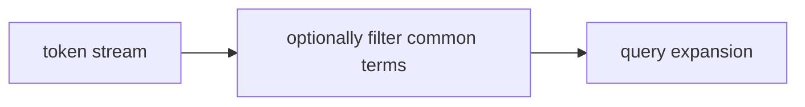

# A12.07 · stopwords

[Phase index](../README.md) · [Foundation] · 25–40 minutes

Prerequisite [A12.06](A12.06.md) · Next [A12.08](A12.08.md)

## 1. The problem & why it exists

Removing common terms makes an exact title impossible to find. Evaluate phrase and language cases before filtering, and keep compatible analyzers.

## 2. Visual mental model



```text
01. token stream
02. optionally filter common terms
03. query expansion
```

Follow the responsibilities in order. The fixture isolates one mechanism. Check the workload and observation point before attributing the result to an actual deployment.

## 3. Step-by-step mechanism & minimal dry-run

Stopword handling trades index size and noise against phrase meaning, domain vocabulary and query semantics.

**Trace.** token stream → optionally filter common terms → query expansion.

## 4. Formal rigor & quantitative math

A four-token phrase with one removed stopword has three indexed tokens, but the original phrase still has four positions.

Predict the worked quantities by hand, then run the [example](../examples/A12.07.py). It uses a small calculation or state model. For arithmetic, retain the units attached to the worked formula.

## 5. Progressive design

| Run | Expected fixture result | Interpretation |
| --- | --- | --- |
| Failure control | `4` | Which assumption from the opening problem leads to this result? |
| Normal control | `3` | Evaluate phrase and language cases before filtering, and keep compatible analyzers. |

When the fixture reports a modeled value, use the lab to check the corresponding workload behavior. Compare work per request, retained bytes, and operational consequences only where the model measures them.

## 6. Safe local lab & controlled failure injection

```sh
uv run python "01-architecture-A01-to-A20/A12-search-rag-and-knowledge-systems/examples/A12.07.py"
uv run python "01-architecture-A01-to-A20/A12-search-rag-and-knowledge-systems/examples/A12.07.py" --break
```

Predict both results and identify which input or branch changes. Rerun the normal control as a repair. In a scratch copy, change one key, bound or assumption and predict the result again. Remove the scratch copy after recording your evidence. Apply this reasoning in [L1](../labs/L1.md).

## 7. Production & multi-cloud bridge

Evaluate phrase and language cases before filtering, and keep compatible analyzers. For deployments on AWS, Azure or Google Cloud, confirm quotas, limits and which observations are available at each service boundary. Run production comparisons with the same query mix and recovery objective.

<details>
<summary>Principal question and answer</summary>

What evidence would distinguish the opening failure from a storage-capacity problem? Start with the first divergent boundary in the trace and name the exact mechanism. Stopword handling trades index size and noise against phrase meaning, domain vocabulary and query semantics.

</details>

## 8. Memory hook & mastery checkpoint

1. Name the operation at the first stage in the trace.
2. Explain the normal and broken outputs before running them.
3. Change one input and compute the revised result with units.
4. How would you test this boundary at deployment scale?
5. What is one assumption that limits the fixture?

<details>
<summary>Check your reasoning</summary>

1. token stream.
2. Normal `3`. Failure `4`.
3. Reapply the relationship in section 4 to your changed inputs.
4. Evaluate phrase and language cases before filtering, and keep compatible analyzers.
5. The example uses a small calculation or state model. Check the primary reference for behavior outside that scope.

</details>

## Standards and implementation notes

- [Manning, Raghavan and Schütze, Introduction to Information Retrieval](https://www.cambridge.org/highereducation/books/introduction-to-information-retrieval/669D108D20F556C5C30957D63B5AB65C)
