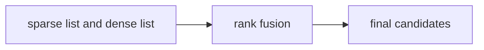

# A12.14 · hybrid sparse+dense search

[Phase index](../README.md) · [Core] · 25–40 minutes

Prerequisite [A12.13](A12.13.md) · Next [A12.15](A12.15.md)

## 1. The problem & why it exists

Lexical and vector rankers disagree, and their raw scores use different units. Compare sparse, dense and hybrid results on fixed judgments and eligible candidates.

## 2. Visual mental model



```text
01. sparse list and dense list
02. rank fusion
03. final candidates
```

Follow the responsibilities in order. The fixture isolates one mechanism. Check the workload and observation point before attributing the result to an actual deployment.

## 3. Step-by-step mechanism & minimal dry-run

Hybrid retrieval can fuse ranks or calibrated scores. Reciprocal rank fusion sums 1/(k+rank) across participating lists.

**Trace.** sparse list and dense list → rank fusion → final candidates.

## 4. Formal rigor & quantitative math

For ranks 1 and 4 with k=60, RRF score is 1/61+1/64≈.03202.

Predict the worked quantities by hand, then run the [example](../examples/A12.14.py). It uses a small calculation or state model. For arithmetic, retain the units attached to the worked formula.

## 5. Progressive design

| Run | Expected fixture result | Interpretation |
| --- | --- | --- |
| Failure control | `0.01639344262295082` | Which assumption from the opening problem leads to this result? |
| Normal control | `0.03202` | Compare sparse, dense and hybrid results on fixed judgments and eligible candidates. |

When the fixture reports a modeled value, use the lab to check the corresponding workload behavior. Compare work per request, retained bytes, and operational consequences only where the model measures them.

## 6. Safe local lab & controlled failure injection

```sh
uv run python "01-architecture-A01-to-A20/A12-search-rag-and-knowledge-systems/examples/A12.14.py"
uv run python "01-architecture-A01-to-A20/A12-search-rag-and-knowledge-systems/examples/A12.14.py" --break
```

Predict both results and identify which input or branch changes. Rerun the normal control as a repair. In a scratch copy, change one key, bound or assumption and predict the result again. Remove the scratch copy after recording your evidence. Apply this reasoning in [L2](../labs/L2.md).

## 7. Production & multi-cloud bridge

Compare sparse, dense and hybrid results on fixed judgments and eligible candidates. For deployments on AWS, Azure or Google Cloud, confirm quotas, limits and which observations are available at each service boundary. Run production comparisons with the same query mix and recovery objective.

<details>
<summary>Principal question and answer</summary>

What evidence would distinguish the opening failure from a storage-capacity problem? Start with the first divergent boundary in the trace and name the exact mechanism. Hybrid retrieval can fuse ranks or calibrated scores. Reciprocal rank fusion sums 1/(k+rank) across participating lists.

</details>

## 8. Memory hook & mastery checkpoint

1. Name the operation at the first stage in the trace.
2. Explain the normal and broken outputs before running them.
3. Change one input and compute the revised result with units.
4. How would you test this boundary at deployment scale?
5. What is one assumption that limits the fixture?

<details>
<summary>Check your reasoning</summary>

1. sparse list and dense list.
2. Normal `0.03202`. Failure `0.01639344262295082`.
3. Reapply the relationship in section 4 to your changed inputs.
4. Compare sparse, dense and hybrid results on fixed judgments and eligible candidates.
5. The example uses a small calculation or state model. Check the primary reference for behavior outside that scope.

</details>

## Standards and implementation notes

- [Primary reference](https://www.elastic.co/docs/reference/elasticsearch/rest-apis/reciprocal-rank-fusion)
