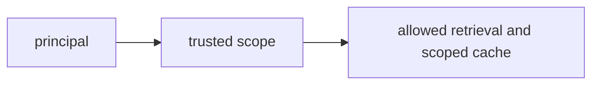

# A12.30 · tenant authorization at query time

[Phase index](../README.md) · [Principal] · 25–40 minutes

Prerequisite [A12.29](A12.29.md) · Next [A12.31](A12.31.md)

## 1. The problem & why it exists

An identical query from another tenant hits a cache containing restricted text. Test denial under every retrieval path, no-result behavior and revision changes.

## 2. Visual mental model



```text
01. principal
02. trusted scope
03. allowed retrieval and scoped cache
```

Follow the responsibilities in order. The fixture isolates one mechanism. Check the workload and observation point before attributing the result to an actual deployment.

## 3. Step-by-step mechanism & minimal dry-run

Authorization should independently constrain every query, candidate and returned source. Cache keys need trusted scope and revision, and mixed-scope sharing needs explicit proof.

**Trace.** principal → trusted scope → allowed retrieval and scoped cache.

## 4. Formal rigor & quantitative math

Two tenants and one query yield two scoped cache entries in this example.

Predict the worked quantities by hand, then run the [example](../examples/A12.30.py). It uses a small calculation or state model. For arithmetic, retain the units attached to the worked formula.

## 5. Progressive design

| Run | Expected fixture result | Interpretation |
| --- | --- | --- |
| Failure control | `1` | Which assumption from the opening problem leads to this result? |
| Normal control | `2` | Test denial under every retrieval path, no-result behavior and revision changes. |

When the fixture reports a modeled value, use the lab to check the corresponding workload behavior. Compare work per request, retained bytes, and operational consequences only where the model measures them.

## 6. Safe local lab & controlled failure injection

```sh
uv run python "01-architecture-A01-to-A20/A12-search-rag-and-knowledge-systems/examples/A12.30.py"
uv run python "01-architecture-A01-to-A20/A12-search-rag-and-knowledge-systems/examples/A12.30.py" --break
```

Predict both results and identify which input or branch changes. Rerun the normal control as a repair. In a scratch copy, change one key, bound or assumption and predict the result again. Remove the scratch copy after recording your evidence. Apply this reasoning in [L3](../labs/L3.md).

## 7. Production & multi-cloud bridge

Test denial under every retrieval path, no-result behavior and revision changes. For deployments on AWS, Azure or Google Cloud, confirm quotas, limits and which observations are available at each service boundary. Run production comparisons with the same query mix and recovery objective.

<details>
<summary>Principal question and answer</summary>

What evidence would distinguish the opening failure from a storage-capacity problem? Start with the first divergent boundary in the trace and name the exact mechanism. Authorization should independently constrain every query, candidate and returned source. Cache keys need trusted scope and revision, and mixed-scope sharing needs explicit proof.

</details>

## 8. Memory hook & mastery checkpoint

1. Name the operation at the first stage in the trace.
2. Explain the normal and broken outputs before running them.
3. Change one input and compute the revised result with units.
4. How would you test this boundary at deployment scale?
5. What is one assumption that limits the fixture?

<details>
<summary>Check your reasoning</summary>

1. principal.
2. Normal `2`. Failure `1`.
3. Reapply the relationship in section 4 to your changed inputs.
4. Test denial under every retrieval path, no-result behavior and revision changes.
5. The example uses a small calculation or state model. Check the primary reference for behavior outside that scope.

</details>

## Standards and implementation notes

- [Primary reference](https://cheatsheetseries.owasp.org/cheatsheets/Authorization_Cheat_Sheet.html)
