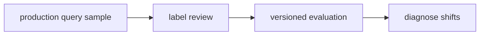

# A12.33 · eval drift and human review

[Phase index](../README.md) · [Principal] · 25–40 minutes

Prerequisite [A12.32](A12.32.md) · Next [A12.34](A12.34.md)

## 1. The problem & why it exists

A fixed benchmark stays green as current user queries change. Record sampling and label policy and compare stable and recent cohorts separately.

## 2. Visual mental model



```text
01. production query sample
02. label review
03. versioned evaluation
04. diagnose shifts
```

Follow the responsibilities in order. The fixture isolates one mechanism. Check the workload and observation point before attributing the result to an actual deployment.

## 3. Step-by-step mechanism & minimal dry-run

Evaluation drift includes changing traffic, source coverage, annotations and expectations. Maintain a stable baseline plus audited rolling slices with human review.

**Trace.** production query sample → label review → versioned evaluation → diagnose shifts.

## 4. Formal rigor & quantitative math

A 20% review sample of 500 cases contains 100 cases under the simplified sampling model.

Predict the worked quantities by hand, then run the [example](../examples/A12.33.py). It uses a small calculation or state model. For arithmetic, retain the units attached to the worked formula.

## 5. Progressive design

| Run | Expected fixture result | Interpretation |
| --- | --- | --- |
| Failure control | `500` | Which assumption from the opening problem leads to this result? |
| Normal control | `100` | Record sampling and label policy and compare stable and recent cohorts separately. |

When the fixture reports a modeled value, use the lab to check the corresponding workload behavior. Compare work per request, retained bytes, and operational consequences only where the model measures them.

## 6. Safe local lab & controlled failure injection

```sh
uv run python "01-architecture-A01-to-A20/A12-search-rag-and-knowledge-systems/examples/A12.33.py"
uv run python "01-architecture-A01-to-A20/A12-search-rag-and-knowledge-systems/examples/A12.33.py" --break
```

Predict both results and identify which input or branch changes. Rerun the normal control as a repair. In a scratch copy, change one key, bound or assumption and predict the result again. Remove the scratch copy after recording your evidence. Apply this reasoning in [L4](../labs/L4.md).

## 7. Production & multi-cloud bridge

Record sampling and label policy and compare stable and recent cohorts separately. For deployments on AWS, Azure or Google Cloud, confirm quotas, limits and which observations are available at each service boundary. Run production comparisons with the same query mix and recovery objective.

<details>
<summary>Principal question and answer</summary>

What evidence would distinguish the opening failure from a storage-capacity problem? Start with the first divergent boundary in the trace and name the exact mechanism. Evaluation drift includes changing traffic, source coverage, annotations and expectations. Maintain a stable baseline plus audited rolling slices with human review.

</details>

## 8. Memory hook & mastery checkpoint

1. Name the operation at the first stage in the trace.
2. Explain the normal and broken outputs before running them.
3. Change one input and compute the revised result with units.
4. How would you test this boundary at deployment scale?
5. What is one assumption that limits the fixture?

<details>
<summary>Check your reasoning</summary>

1. production query sample.
2. Normal `100`. Failure `500`.
3. Reapply the relationship in section 4 to your changed inputs.
4. Record sampling and label policy and compare stable and recent cohorts separately.
5. The example uses a small calculation or state model. Check the primary reference for behavior outside that scope.

</details>

## Standards and implementation notes

- [Primary reference](https://cheatsheetseries.owasp.org/cheatsheets/LLM_Prompt_Injection_Prevention_Cheat_Sheet.html)
