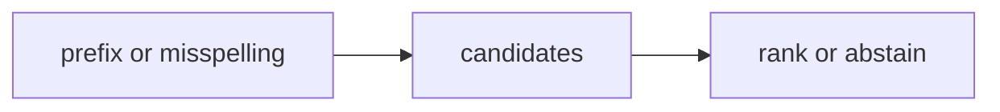

# A12.34 · autocomplete and spell correction

[Phase index](../README.md) · [Principal] · 25–40 minutes

Prerequisite [A12.33](A12.33.md) · Next [Exit gate](../README.md#practice-and-exit-gate)

## 1. The problem & why it exists

An autocomplete suggestion changes a valid rare identifier into a common word. Keep exact lookup available and evaluate rare, multilingual and protected terms.

## 2. Visual mental model



```text
01. prefix or misspelling
02. candidates
03. rank or abstain
```

Follow the responsibilities in order. The fixture isolates one mechanism. Check the workload and observation point before attributing the result to an actual deployment.

## 3. Step-by-step mechanism & minimal dry-run

Autocomplete ranks prefix candidates under context and policy. Spell correction compares candidate costs and language evidence, leaving valid exact matches where appropriate.

**Trace.** prefix or misspelling → candidates → rank or abstain.

## 4. Formal rigor & quantitative math

At maximum edit distance one, a candidate requiring two edits is excluded in a simple policy.

Predict the worked quantities by hand, then run the [example](../examples/A12.34.py). It uses a small calculation or state model. For arithmetic, retain the units attached to the worked formula.

## 5. Progressive design

| Run | Expected fixture result | Interpretation |
| --- | --- | --- |
| Failure control | `2` | Which assumption from the opening problem leads to this result? |
| Normal control | `1` | Keep exact lookup available and evaluate rare, multilingual and protected terms. |

When the fixture reports a modeled value, use the lab to check the corresponding workload behavior. Compare work per request, retained bytes, and operational consequences only where the model measures them.

## 6. Safe local lab & controlled failure injection

```sh
uv run python "01-architecture-A01-to-A20/A12-search-rag-and-knowledge-systems/examples/A12.34.py"
uv run python "01-architecture-A01-to-A20/A12-search-rag-and-knowledge-systems/examples/A12.34.py" --break
```

Predict both results and identify which input or branch changes. Rerun the normal control as a repair. In a scratch copy, change one key, bound or assumption and predict the result again. Remove the scratch copy after recording your evidence. Apply this reasoning in [L4](../labs/L4.md).

## 7. Production & multi-cloud bridge

Keep exact lookup available and evaluate rare, multilingual and protected terms. For deployments on AWS, Azure or Google Cloud, confirm quotas, limits and which observations are available at each service boundary. Run production comparisons with the same query mix and recovery objective.

<details>
<summary>Principal question and answer</summary>

What evidence would distinguish the opening failure from a storage-capacity problem? Start with the first divergent boundary in the trace and name the exact mechanism. Autocomplete ranks prefix candidates under context and policy. Spell correction compares candidate costs and language evidence, leaving valid exact matches where appropriate.

</details>

## 8. Memory hook & mastery checkpoint

1. Name the operation at the first stage in the trace.
2. Explain the normal and broken outputs before running them.
3. Change one input and compute the revised result with units.
4. How would you test this boundary at deployment scale?
5. What is one assumption that limits the fixture?

<details>
<summary>Check your reasoning</summary>

1. prefix or misspelling.
2. Normal `1`. Failure `2`.
3. Reapply the relationship in section 4 to your changed inputs.
4. Keep exact lookup available and evaluate rare, multilingual and protected terms.
5. The example uses a small calculation or state model. Check the primary reference for behavior outside that scope.

</details>

## Standards and implementation notes

- [Primary reference](https://nlp.stanford.edu/IR-book/html/htmledition/irbook.html)
