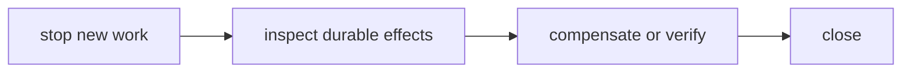

# A13.32 · supervision and rollback

[Phase index](../README.md) · [Principal] · 25–40 minutes

Prerequisite [A13.31](A13.31.md) · Next [Exit gate](../README.md#practice-and-exit-gate)

## 1. The problem & why it exists

A supervisor stops a run but leaves writes and resources behind. Define rollback scope, authority and confirmation before changing externally visible state.

## 2. Visual mental model



```text
01. stop new work
02. inspect durable effects
03. compensate or verify
04. close
```

Follow the responsibilities in order. The fixture isolates one mechanism. Check the workload and observation point before attributing the result to an actual deployment.

## 3. Step-by-step mechanism & minimal dry-run

Supervision includes interrupting execution, observing outstanding work and reconciling side effects. Rollback may be compensation, not database undo.

**Trace.** stop new work → inspect durable effects → compensate or verify → close.

## 4. Formal rigor & quantitative math

If three resources were allocated and two have confirmed cleanup, one still needs reconciliation.

Predict the worked quantities by hand, then run the [example](../examples/A13.32.py). It uses a small calculation or state model. For arithmetic, retain the units attached to the worked formula.

## 5. Progressive design

| Run | Expected fixture result | Interpretation |
| --- | --- | --- |
| Failure control | `3` | Which assumption from the opening problem leads to this result? |
| Normal control | `1` | Define rollback scope, authority and confirmation before changing externally visible state. |

When the fixture reports a modeled value, use the lab to check the corresponding workload behavior. Compare work per request, retained bytes, and operational consequences only where the model measures them.

## 6. Safe local lab & controlled failure injection

```sh
uv run python "01-architecture-A01-to-A20/A13-agentic-ai-mcp-orchestration/examples/A13.32.py"
uv run python "01-architecture-A01-to-A20/A13-agentic-ai-mcp-orchestration/examples/A13.32.py" --break
```

Predict both results and identify which input or branch changes. Rerun the normal control as a repair. In a scratch copy, change one key, bound or assumption and predict the result again. Remove the scratch copy after recording your evidence. Apply this reasoning in [L4](../labs/L4.md).

## 7. Production & multi-cloud bridge

Define rollback scope, authority and confirmation before changing externally visible state. For deployments on AWS, Azure or Google Cloud, confirm quotas, limits and which observations are available at each service boundary. Run production comparisons with the same query mix and recovery objective.

<details>
<summary>Principal question and answer</summary>

What evidence would distinguish the opening failure from a storage-capacity problem? Start with the first divergent boundary in the trace and name the exact mechanism. Supervision includes interrupting execution, observing outstanding work and reconciling side effects. Rollback may be compensation, not database undo.

</details>

## 8. Memory hook & mastery checkpoint

1. Name the operation at the first stage in the trace.
2. Explain the normal and broken outputs before running them.
3. Change one input and compute the revised result with units.
4. How would you test this boundary at deployment scale?
5. What is one assumption that limits the fixture?

<details>
<summary>Check your reasoning</summary>

1. stop new work.
2. Normal `1`. Failure `3`.
3. Reapply the relationship in section 4 to your changed inputs.
4. Define rollback scope, authority and confirmation before changing externally visible state.
5. The example uses a small calculation or state model. Check the primary reference for behavior outside that scope.

</details>

## Standards and implementation notes

- [Primary reference](https://docs.aws.amazon.com/prescriptive-guidance/latest/cloud-design-patterns/saga-patterns.html)
