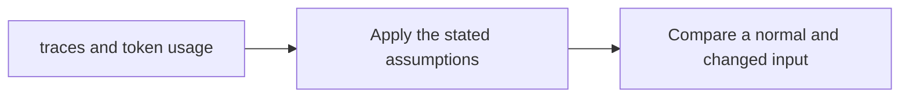

# A14.05 · traces and token usage

[A14.04](A14.04.md) · Foundation · [A14.06](A14.06.md)

## Problem

A dashboard hides retrieved context in input token counts.

## Mechanism

Measure provider-reported input/output once per call. Attribute known subdivisions separately and reserve a category for unattributed input; cached-token units follow the provider contract.



## Worked example

Total input is 500 with 300 explicitly retrieved. Charging 500+300 counts those tokens twice.

Read the [executable calculation](../examples/A14.05.py) after predicting both outcomes.

```sh
uv run --locked python "01-architecture-A01-to-A20/A14-advanced-llmops-evals-safety/examples/A14.05.py"
uv run --locked python "01-architecture-A01-to-A20/A14-advanced-llmops-evals-safety/examples/A14.05.py" --break
```

Expected outputs are `560` and `860` respectively. Record the changed input, formula or invariant and restore the original control.

## Check your reasoning

1. What assumption is violated in the opening problem?
2. Compute the first result without running the file.
3. Identify the first observable difference in the alternate run.
4. State one change to the input that would exercise the boundary more sharply.
5. Why can sibling spans overlap without doubling billable usage?

<details>
<summary>Feedback</summary>

Compare the opening failure with the mechanism above. The observed results are `560` and `860`. Check the derivation against the worked example. For your additional boundary case, write the expected behavior before executing it. For the transfer question, name the policy, invariant or measurable assumption the decision depends on and identify evidence that would falsify it.

</details>

Compare the first decisive intermediate observation before changing the fixture. Use [L1](../labs/L1.md) for phase-level practice.

## Primary source

- [Reference for traces and token usage](https://opentelemetry.io/docs/specs/semconv/gen-ai/gen-ai-metrics/)
