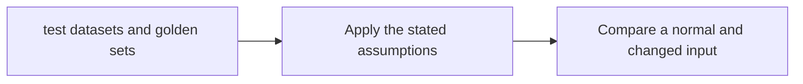

# A14.06 · test datasets and golden sets

[A14.05](A14.05.md) · Core · [A14.07](A14.07.md)

## Problem

A benchmark tuned repeatedly becomes a development set.

## Mechanism

Separate development cases and held-out release cases by provenance groups. Freeze review, labels and membership, then add new regression cases without silently editing the old release.



## Worked example

Two paraphrases share group g1. Group-based splitting puts one group in train and the other in test, with zero shared groups.

Read the [executable calculation](../examples/A14.06.py) after predicting both outcomes.

```sh
uv run --locked python "01-architecture-A01-to-A20/A14-advanced-llmops-evals-safety/examples/A14.06.py"
uv run --locked python "01-architecture-A01-to-A20/A14-advanced-llmops-evals-safety/examples/A14.06.py" --break
```

Expected outputs are `0` and `1` respectively. Record the changed input, formula or invariant and restore the original control.

## Check your reasoning

1. What assumption is violated in the opening problem?
2. Compute the first result without running the file.
3. Identify the first observable difference in the alternate run.
4. State one change to the input that would exercise the boundary more sharply.
5. How could synthetic paraphrases cross a split even when strings differ?

<details>
<summary>Feedback</summary>

Compare the opening failure with the mechanism above. The observed results are `0` and `1`. Check the derivation against the worked example. For your additional boundary case, write the expected behavior before executing it. For the transfer question, name the policy, invariant or measurable assumption the decision depends on and identify evidence that would falsify it.

</details>

Compare the first decisive intermediate observation before changing the fixture. Use [L1](../labs/L1.md) for phase-level practice.

## Primary source

- [Reference for test datasets and golden sets](https://platform.openai.com/docs/guides/evaluation-best-practices)
