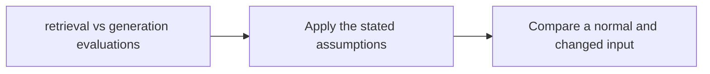

# A14.07 · retrieval vs generation evaluations

[A14.06](A14.06.md) · Core · [A14.08](A14.08.md)

## Problem

A correct answer hides a retrieval or evidence defect.

## Mechanism

Score retrieval against expected sources and answer against accepted content. Record the failure stage; a lucky guess can pass answer scoring with no evidence.



## Worked example

Expected source s2 ranks second among two. Recall@1=0 and Recall@2=1; answer success is a separate bit.

Read the [executable calculation](../examples/A14.07.py) after predicting both outcomes.

```sh
uv run --locked python "01-architecture-A01-to-A20/A14-advanced-llmops-evals-safety/examples/A14.07.py"
uv run --locked python "01-architecture-A01-to-A20/A14-advanced-llmops-evals-safety/examples/A14.07.py" --break
```

Expected outputs are `(0, 1)` and `1` respectively. Record the changed input, formula or invariant and restore the original control.

## Check your reasoning

1. What assumption is violated in the opening problem?
2. Compute the first result without running the file.
3. Identify the first observable difference in the alternate run.
4. State one change to the input that would exercise the boundary more sharply.
5. What metric identifies lucky unsupported answers?

<details>
<summary>Feedback</summary>

Compare the opening failure with the mechanism above. The observed results are `(0, 1)` and `1`. Check the derivation against the worked example. For your additional boundary case, write the expected behavior before executing it. For the transfer question, name the policy, invariant or measurable assumption the decision depends on and identify evidence that would falsify it.

</details>

Compare the first decisive intermediate observation before changing the fixture. Use [L1](../labs/L1.md) for phase-level practice.

## Primary source

- [Reference for retrieval vs generation evaluations](https://platform.openai.com/docs/guides/evaluation-best-practices)
