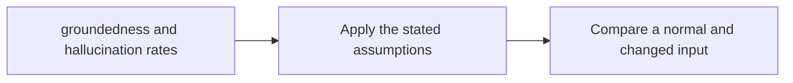

# A14.08 · groundedness and hallucination rates

[A14.07](A14.07.md) · Core · [A14.09](A14.09.md)

## Problem

A well-formed citation points to unrelated evidence.

## Mechanism

Break text into checkable claims, ensure cited evidence exists, then judge whether it supports each claim. Track unsupported and unverifiable separately by rubric.



## Worked example

Three checkable claims have labels supported, supported, unsupported. Unsupported rate is 1/3, whereas all three list a citation.

Read the [executable calculation](../examples/A14.08.py) after predicting both outcomes.

```sh
uv run --locked python "01-architecture-A01-to-A20/A14-advanced-llmops-evals-safety/examples/A14.08.py"
uv run --locked python "01-architecture-A01-to-A20/A14-advanced-llmops-evals-safety/examples/A14.08.py" --break
```

Expected outputs are `0.3333333333333333` and `0.0` respectively. Record the changed input, formula or invariant and restore the original control.

## Check your reasoning

1. What assumption is violated in the opening problem?
2. Compute the first result without running the file.
3. Identify the first observable difference in the alternate run.
4. State one change to the input that would exercise the boundary more sharply.
5. When should a correct unverifiable claim still trigger abstention?

<details>
<summary>Feedback</summary>

Compare the opening failure with the mechanism above. The observed results are `0.3333333333333333` and `0.0`. Check the derivation against the worked example. For your additional boundary case, write the expected behavior before executing it. For the transfer question, name the policy, invariant or measurable assumption the decision depends on and identify evidence that would falsify it.

</details>

Compare the first decisive intermediate observation before changing the fixture. Use [L2](../labs/L2.md) for phase-level practice.

## Primary source

- [Reference for groundedness and hallucination rates](https://nvlpubs.nist.gov/nistpubs/AI/NIST.AI.600-1.pdf)
