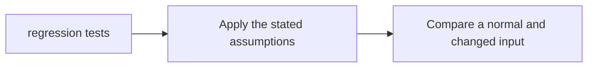

# A14.10 · regression tests

[A14.09](A14.09.md) · Core · [A14.11](A14.11.md)

## Problem

An aggregate pass hides a high-risk regression.

## Mechanism

Apply both overall and slice-level thresholds. Keep a mandatory veto for high-severity policy failures. Compare on the same held-out fixtures.



## Worked example

99 of 100 pass, including zero of one safety-critical case. An overall 95% gate alone accepts.

Read the [executable calculation](../examples/A14.10.py) after predicting both outcomes.

```sh
uv run --locked python "01-architecture-A01-to-A20/A14-advanced-llmops-evals-safety/examples/A14.10.py"
uv run --locked python "01-architecture-A01-to-A20/A14-advanced-llmops-evals-safety/examples/A14.10.py" --break
```

Expected outputs are `False` and `True` respectively. Record the changed input, formula or invariant and restore the original control.

## Check your reasoning

1. What assumption is violated in the opening problem?
2. Compute the first result without running the file.
3. Identify the first observable difference in the alternate run.
4. State one change to the input that would exercise the boundary more sharply.
5. How do you distinguish a veto from a tunable threshold?

<details>
<summary>Feedback</summary>

Compare the opening failure with the mechanism above. The observed results are `False` and `True`. Check the derivation against the worked example. For your additional boundary case, write the expected behavior before executing it. For the transfer question, name the policy, invariant or measurable assumption the decision depends on and identify evidence that would falsify it.

</details>

Compare the first decisive intermediate observation before changing the fixture. Use [L2](../labs/L2.md) for phase-level practice.

## Primary source

- [Reference for regression tests](https://platform.openai.com/docs/guides/evaluation-best-practices)
