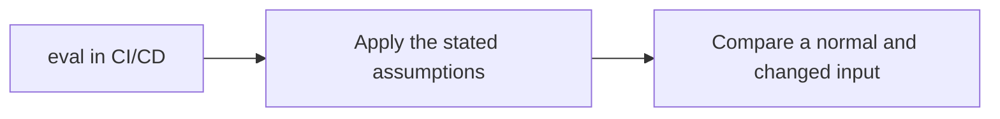

# A14.12 · eval in CI/CD

[A14.11](A14.11.md) · Core · [A14.13](A14.13.md)

## Problem

Optional evaluation quietly succeeds without data.

## Mechanism

Validate expected case count and version before executing the release gate. Treat missing data or an evaluator exception as an unavailable result and keep the release on hold.



## Worked example

A gate requires three outcomes, all passing. An empty list satisfies Python all and fails the required-count check.

Read the [executable calculation](../examples/A14.12.py) after predicting both outcomes.

```sh
uv run --locked python "01-architecture-A01-to-A20/A14-advanced-llmops-evals-safety/examples/A14.12.py"
uv run --locked python "01-architecture-A01-to-A20/A14-advanced-llmops-evals-safety/examples/A14.12.py" --break
```

Expected outputs are `False` and `True` respectively. Record the changed input, formula or invariant and restore the original control.

## Check your reasoning

1. What assumption is violated in the opening problem?
2. Compute the first result without running the file.
3. Identify the first observable difference in the alternate run.
4. State one change to the input that would exercise the boundary more sharply.
5. How should a release behave when the judge is unavailable?

<details>
<summary>Feedback</summary>

Compare the opening failure with the mechanism above. The observed results are `False` and `True`. Check the derivation against the worked example. For your additional boundary case, write the expected behavior before executing it. For the transfer question, name the policy, invariant or measurable assumption the decision depends on and identify evidence that would falsify it.

</details>

Compare the first decisive intermediate observation before changing the fixture. Use [L2](../labs/L2.md) for phase-level practice.

## Primary source

- [Reference for eval in CI/CD](https://sre.google/workbook/canarying-releases/)
