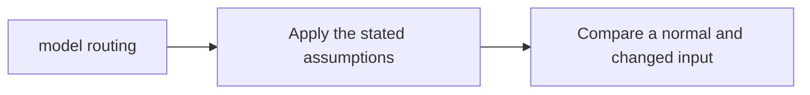

# A14.13 · model routing

[A14.12](A14.12.md) · Core · [A14.14](A14.14.md)

## Problem

A cheap route receives requests that exceed its context or policy.

## Mechanism

Filter candidates by capability and policy before optimizing for cost. Use a default abstention when no candidate qualifies and record the reason.



## Worked example

A 900-token input needs a limit of at least 900. A cheap route at 512 is filtered, leaving the 1024-token route.

Read the [executable calculation](../examples/A14.13.py) after predicting both outcomes.

```sh
uv run --locked python "01-architecture-A01-to-A20/A14-advanced-llmops-evals-safety/examples/A14.13.py"
uv run --locked python "01-architecture-A01-to-A20/A14-advanced-llmops-evals-safety/examples/A14.13.py" --break
```

Expected outputs are `(4, 1024)` and `(1, 512)` respectively. Record the changed input, formula or invariant and restore the original control.

## Check your reasoning

1. What assumption is violated in the opening problem?
2. Compute the first result without running the file.
3. Identify the first observable difference in the alternate run.
4. State one change to the input that would exercise the boundary more sharply.
5. What is the observed cost of fallback traffic?

<details>
<summary>Feedback</summary>

Compare the opening failure with the mechanism above. The observed results are `(4, 1024)` and `(1, 512)`. Check the derivation against the worked example. For your additional boundary case, write the expected behavior before executing it. For the transfer question, name the policy, invariant or measurable assumption the decision depends on and identify evidence that would falsify it.

</details>

Compare the first decisive intermediate observation before changing the fixture. Use [L2](../labs/L2.md) for phase-level practice.

## Primary source

- [Reference for model routing](https://sre.google/workbook/canarying-releases/)
