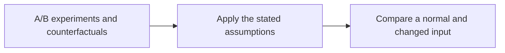

# A14.19 · A/B experiments and counterfactuals

[A14.18](A14.18.md) · Principal · [A14.20](A14.20.md)

## Problem

Treatment and control see different source devices.

## Mechanism

Assign by stable unit and use intention-to-treat denominators. An observational difference estimates association unless a defensible identification strategy handles confounding.



## Worked example

Control 40/100 and treatment 48/100 yields an 8 percentage-point difference. Dividing by 0.4 instead yields 20% relative lift.

Read the [executable calculation](../examples/A14.19.py) after predicting both outcomes.

```sh
uv run --locked python "01-architecture-A01-to-A20/A14-advanced-llmops-evals-safety/examples/A14.19.py"
uv run --locked python "01-architecture-A01-to-A20/A14-advanced-llmops-evals-safety/examples/A14.19.py" --break
```

Expected outputs are `0.08` and `0.2` respectively. Record the changed input, formula or invariant and restore the original control.

## Check your reasoning

1. What assumption is violated in the opening problem?
2. Compute the first result without running the file.
3. Identify the first observable difference in the alternate run.
4. State one change to the input that would exercise the boundary more sharply.
5. Why is a cohort-balanced assignment needed before outcome analysis?

<details>
<summary>Feedback</summary>

Compare the opening failure with the mechanism above. The observed results are `0.08` and `0.2`. Check the derivation against the worked example. For your additional boundary case, write the expected behavior before executing it. For the transfer question, name the policy, invariant or measurable assumption the decision depends on and identify evidence that would falsify it.

</details>

Compare the first decisive intermediate observation before changing the fixture. Use [L3](../labs/L3.md) for phase-level practice.

## Primary source

- [Reference for A/B experiments and counterfactuals](https://sre.google/workbook/canarying-releases/)
