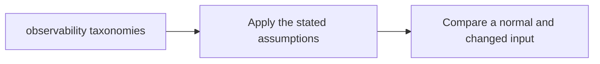

# A14.21 · observability taxonomies

[A14.20](A14.20.md) · Principal · [A14.22](A14.22.md)

## Problem

Failures vanish when unknown tags are silently dropped.

## Mechanism

Use a stable low-cardinality error class and a trace ID for investigation. Separate transport failure, policy denial and invalid output from domain outcomes.



## Worked example

Three events have one timeout and two different external IDs. Counting raw IDs yields three series; counting the single failure class yields one.

Read the [executable calculation](../examples/A14.21.py) after predicting both outcomes.

```sh
uv run --locked python "01-architecture-A01-to-A20/A14-advanced-llmops-evals-safety/examples/A14.21.py"
uv run --locked python "01-architecture-A01-to-A20/A14-advanced-llmops-evals-safety/examples/A14.21.py" --break
```

Expected outputs are `1` and `3` respectively. Record the changed input, formula or invariant and restore the original control.

## Check your reasoning

1. What assumption is violated in the opening problem?
2. Compute the first result without running the file.
3. Identify the first observable difference in the alternate run.
4. State one change to the input that would exercise the boundary more sharply.
5. Which fields belong in logs instead of metric labels?

<details>
<summary>Feedback</summary>

Compare the opening failure with the mechanism above. The observed results are `1` and `3`. Check the derivation against the worked example. For your additional boundary case, write the expected behavior before executing it. For the transfer question, name the policy, invariant or measurable assumption the decision depends on and identify evidence that would falsify it.

</details>

Compare the first decisive intermediate observation before changing the fixture. Use [L3](../labs/L3.md) for phase-level practice.

## Primary source

- [Reference for observability taxonomies](https://opentelemetry.io/docs/specs/semconv/gen-ai/gen-ai-metrics/)
