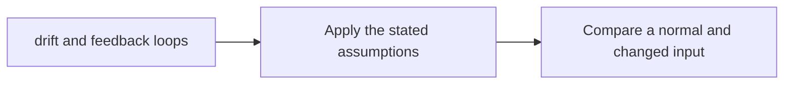

# A14.22 · drift and feedback loops

[A14.21](A14.21.md) · Principal · [A14.23](A14.23.md)

## Problem

Unchanged aggregate pass rate hides population drift.

## Mechanism

Compare input or cohort frequency, feedback coverage and cohort-level outcomes. Outcome drift requires delayed ground truth or an explicitly identified proxy.



## Worked example

Easy share moves 80/100 to 60/100 while evaluator score stays 90/100. Easy share falls by 20 points.

Read the [executable calculation](../examples/A14.22.py) after predicting both outcomes.

```sh
uv run --locked python "01-architecture-A01-to-A20/A14-advanced-llmops-evals-safety/examples/A14.22.py"
uv run --locked python "01-architecture-A01-to-A20/A14-advanced-llmops-evals-safety/examples/A14.22.py" --break
```

Expected outputs are `-0.2` and `0.0` respectively. Record the changed input, formula or invariant and restore the original control.

## Check your reasoning

1. What assumption is violated in the opening problem?
2. Compute the first result without running the file.
3. Identify the first observable difference in the alternate run.
4. State one change to the input that would exercise the boundary more sharply.
5. What signal distinguishes traffic mix from quality drift?

<details>
<summary>Feedback</summary>

Compare the opening failure with the mechanism above. The observed results are `-0.2` and `0.0`. Check the derivation against the worked example. For your additional boundary case, write the expected behavior before executing it. For the transfer question, name the policy, invariant or measurable assumption the decision depends on and identify evidence that would falsify it.

</details>

Compare the first decisive intermediate observation before changing the fixture. Use [L4](../labs/L4.md) for phase-level practice.

## Primary source

- [Reference for drift and feedback loops](https://scikit-learn.org/stable/modules/model_evaluation.html)
