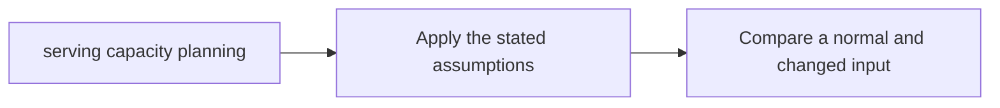

# A14.26 · serving capacity planning

[A14.25](A14.25.md) · Principal · [A14.27](A14.27.md)

## Problem

Planning assumes service rate equals average offered load indefinitely.

## Mechanism

Estimate arrival and service rates in the same units. Headroom, queue memory and burst admission matter before saturation; measure observed percentiles under realistic requests.



## Worked example

Four workers at 20 requests/s provide nominal 80. At 60 requests/s, utilization is 0.75; loss of two workers raises it to 1.5.

Read the [executable calculation](../examples/A14.26.py) after predicting both outcomes.

```sh
uv run --locked python "01-architecture-A01-to-A20/A14-advanced-llmops-evals-safety/examples/A14.26.py"
uv run --locked python "01-architecture-A01-to-A20/A14-advanced-llmops-evals-safety/examples/A14.26.py" --break
```

Expected outputs are `0.75` and `1.5` respectively. Record the changed input, formula or invariant and restore the original control.

## Check your reasoning

1. What assumption is violated in the opening problem?
2. Compute the first result without running the file.
3. Identify the first observable difference in the alternate run.
4. State one change to the input that would exercise the boundary more sharply.
5. What is the overload mode when demand exceeds sustainable service?

<details>
<summary>Feedback</summary>

Compare the opening failure with the mechanism above. The observed results are `0.75` and `1.5`. Check the derivation against the worked example. For your additional boundary case, write the expected behavior before executing it. For the transfer question, name the policy, invariant or measurable assumption the decision depends on and identify evidence that would falsify it.

</details>

Compare the first decisive intermediate observation before changing the fixture. Use [L4](../labs/L4.md) for phase-level practice.

## Primary source

- [Reference for serving capacity planning](https://sre.google/workbook/canarying-releases/)
