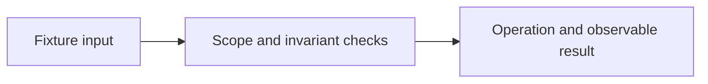

# A14 · LLM golden-set evaluator

[Phase index](../../README.md)

Score answer, grounding and tenant-scope dimensions separately on a complete versioned golden set. Meter synthetic tokens with explicit rates.

## Architecture

## Acceptance evidence

- [L1](../../labs/L1.md). Record answer passes and name the failed case.
- [L2](../../labs/L2.md). Record total metered units and show why the retrieval subset is not billed twice.

Run the verification commands from the linked labs. Inspect the [guided source](guided.py) after predicting the outcome.
