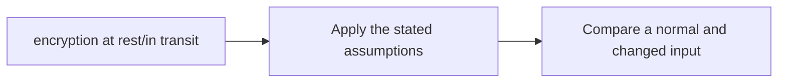

# A15.04 · encryption at rest/in transit

[A15.03](A15.03.md) · Foundation · [A15.05](A15.05.md)

## Problem

Storage encryption is assumed to protect requests in transit.

## Mechanism

Use TLS with verified peers for transport and managed encryption on storage. Decrypted authorized reads, logs, backups and intermediaries require separate controls.



## Worked example

Three hops require verified TLS. The middle hop has no peer verification, so the path fails the transport invariant.

Read the [executable calculation](../examples/A15.04.py) after predicting both outcomes.

```sh
uv run --locked python "01-architecture-A01-to-A20/A15-security-privacy-global-scale/examples/A15.04.py"
uv run --locked python "01-architecture-A01-to-A20/A15-security-privacy-global-scale/examples/A15.04.py" --break
```

Expected outputs are `False` and `True` respectively. Record the changed input, formula or invariant and restore the original control.

## Check your reasoning

1. What assumption is violated in the opening problem?
2. Compute the first result without running the file.
3. Identify the first observable difference in the alternate run.
4. State one change to the input that would exercise the boundary more sharply.
5. Name a plaintext boundary even with end-to-end transport protection.

<details>
<summary>Feedback</summary>

Compare the opening failure with the mechanism above. The observed results are `False` and `True`. Check the derivation against the worked example. For your additional boundary case, write the expected behavior before executing it. For the transfer question, name the policy, invariant or measurable assumption the decision depends on and identify evidence that would falsify it.

</details>

Compare the first decisive intermediate observation before changing the fixture. Use [L1](../labs/L1.md) for phase-level practice.

## Primary source

- [Reference for encryption at rest/in transit](https://www.rfc-editor.org/rfc/rfc8446.html)
